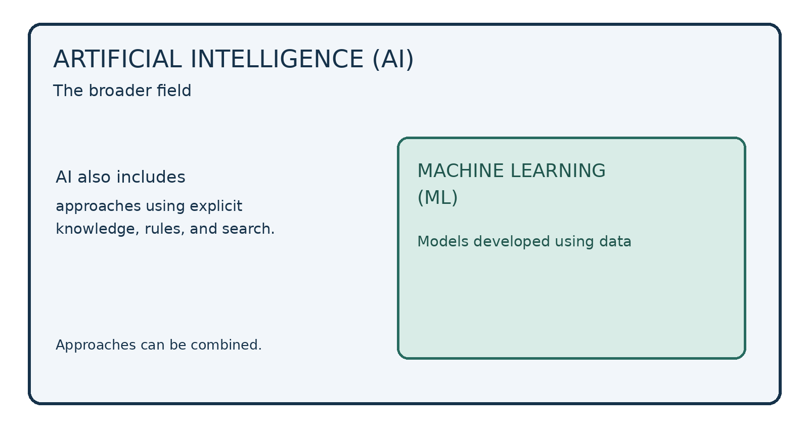

# Introduction to AI: the 45-minute demo
**Teacher’s live script • 8 pages • Two accounts • One shared document**

## What students should see
A small piece of checked research becomes a readable Markdown document. A second account improves the same document. GitHub keeps a record of that change. The shared content can then support a study guide, slides, or a video.

**Before class:** create the repository and give account B access using page 2. During class, students watch. They do not need to sign in or follow each click.

## Keep this timetable visible
| Time | On screen | Guide |
| --- | --- | --- |
| 0–3 min | Introduce the small task | Page 3 |
| 3–8 min | One AI prompt; check one source | Page 3 |
| 8–12 min | Open the prepared repository | Page 4 |
| 12–22 min | Paste Markdown; preview; save | Page 4 |
| 22–28 min | Upload and display one image | Page 5 |
| 28–34 min | Account B adds an example; show history | Page 6 |
| 34–40 min | Connect to outputs; show previous work | Page 7 |
| 40–45 min | Questions, recap, and delay allowance | Page 8 |

## Have these ready
- **Two separate browser sessions:** for example, Chrome signed in to GitHub account A and Edge signed in to account B. Two ordinary tabs in one browser usually share the same login.
- The demo pack extracted into a folder you can find easily. Open `research-prompt.txt`, `lesson-start.md`, and `second-account-addition.md` in a plain-text editor.
- Your usual AI tool, plus the Stanford AI definition page linked on page 3, already open.
- One previous project: preselect one document page, one slide, and a 20–30-second video excerpt if available. Open them in advance.

**Rehearse once:** verify that B can edit this repository directly. Leave only the initial README in it for the live session. Use a fresh repository name if your usual demo name is already taken.

**How to use this guide:** read SAY aloud; perform DO; copy PASTE. Do not read the preparation notes aloud. Use the supplied text instead of typing whole paragraphs live.

[[PAGE]]

# Before class: set up the two accounts
**Preparation only — outside the 45-minute session**

## 1. Account A: create the shared repository
1. In browser A, sign in to GitHub with account A. Open [github.com/new](https://github.com/new).
2. Set **Owner** to account A. Enter **Repository name:** `mini-ai-demo`.
3. Enter **Description:** `A tiny AI lesson written in Markdown.`
4. Select **Private**. Turn on **Add README**. Leave the other initialization options at their defaults; do not ask an AI agent to generate the project.
5. Click **Create repository**. Keep this repository’s address handy.

The initial README can simply contain the repository name. You will replace its contents live. A private repository is sufficient for projection; distribute the guide separately afterwards.

## 2. Account A: invite account B
1. Inside the repository, click **Settings**.
2. Under **Access**, choose **Collaborators**, then **Add people**.
3. Search for account B’s exact GitHub username and select that account.
4. Click the button to add that account to the repository.

## 3. Account B: accept and check access
1. In browser B, sign in to GitHub with account B.
2. Open the invitation email for B. Open its invitation link in **browser B**, then accept the invitation.
3. Open the same repository address in browser B. Click `README.md`, then its pencil-shaped **Edit** button.
4. Confirm that the editor opens without asking you to fork the repository. Leave without saving. Keep this browser ready on the repository page.

Use a personal repository with the default editable `main` branch for this demonstration. Both accounts will save directly to `main`; no branches, pull requests, or approvals are part of the live exercise.

## Final check
- Keep both accounts signed in; complete any authentication prompts now.
- Confirm the image file `ai-and-ml.png` is in the extracted demo pack.
- Do not leave an unsaved editor open when switching accounts during the lesson. Each account should open the latest saved file.
- Keep `lesson-finished.md` available as a fallback. It contains the exact completed lesson, including the image reference and B’s addition.

[[PAGE]]

# 0–8 minutes: explain, research, check
## 0–3 min · Establish the purpose
**DO:** Show the initial repository page in browser A.

**SAY:** “Last class, we discussed what you will produce in this course. Today I will show you a tiny version of the process. Our topic is Introduction to AI. We will research a few ideas, put them in a shared document, make it readable, and improve it using another account.”

**SAY:** “Please watch rather than try to follow every click. I will share this demonstration afterwards. I control both accounts today; they represent two members of a group.”

## 3–6 min · Ask one focused research question
**DO:** Open your AI tool. Paste the text below from `research-prompt.txt` and submit it. Use its search or browsing option if available.

**PASTE:**
```text
Help me research a tiny lesson called "Introduction to AI" for
first-year university students with no technical background.

In no more than 150 words:
1. Explain AI and machine learning in simple language.
2. Explain how they are related.
3. Give an email spam-filter example and one possible mistake.

Find two reliable educational sources and give their links.
Say if you cannot browse or verify a source. Do not invent links.
This is a starting draft that I will check before using.
```

**SAY:** “Notice that I specified the audience, the topic, the length, and the sources. I am asking for a small starting point, not a whole textbook.”

**DO:** Point to one definition and one source in the answer. Do not read the entire answer or keep refining the prompt. If it takes more than one minute, move to the prepared source below.

## 6–8 min · Check one claim visibly
**DO:** Open [Stanford HAI: What is Artificial Intelligence?](https://hai.stanford.edu/ai-definitions/what-is-artificial-intelligence-ai). Point to its definition and examples. Compare the AI answer’s definition with this source.

**SAY:** “The source describes AI through tasks such as understanding language and recognizing images. I will use a short explanation in my own words and keep the source link. A confident AI answer is still something we need to check.”

**SAY:** “For the rest of the demonstration, I have prepared a short lesson so you do not have to watch me type. It uses the sources listed at the bottom. In your own work, you would check the important claims before sharing the draft.”

[[PAGE]]

# 8–22 minutes: make a readable document
## 8–12 min · Open the project
**DO:** Return to browser A. Point to the repository name and `README.md`.

**SAY:** “A repository is our shared project folder with a history of changes. README.md is a text file. The .md ending tells us it uses Markdown, which adds simple formatting to ordinary text.”

## 12–22 min · Paste, preview, and save
**DO:** Click `README.md`, then the pencil **Edit** button. Select the text inside the editor and replace it with `lesson-start.md`, shown below. Copy the content, not the surrounding code-box markers.

```markdown
# Introduction to AI

**Goal:** Explain AI and machine learning using an everyday example.

## Two key ideas
- **Artificial intelligence (AI)** is the broad field of building
  computer systems for tasks such as recognizing images,
  understanding language, and reasoning.
- **Machine learning (ML)** is an approach within AI that uses
  data to develop models for predictions or other outputs.

## AI and ML
| Term | Main idea |
| --- | --- |
| AI | The broader field |
| ML | An AI approach that learns patterns from data |

## Remember
AI systems can make mistakes. Check important outputs.

## Sources
- [Stanford HAI: AI][ai]
- [Stanford HAI: ML][ml]
- [Google: Introduction to ML][google]

[ai]: https://hai.stanford.edu/ai-definitions/what-is-artificial-intelligence-ai
[ml]: https://hai.stanford.edu/ai-definitions/what-is-machine-learning
[google]: https://developers.google.com/machine-learning/intro-to-ml/what-is-ml

```

**DO:** Click **Preview**. Point to the title, bold terms, bullet list, table, and source links.

**SAY:** “One hash makes the main heading; two make a section heading. Asterisks make bold text, and a dash starts a bullet. The table uses vertical bars. Preview shows these marks as a readable document. You do not need to memorize the syntax today.”

**DO:** Click **Commit changes…**. Enter `Add short AI lesson`. Choose **Commit directly to the main branch**, then confirm **Commit changes**.

**SAY:** “A commit saves a recorded change. The message explains what I changed.”

[[PAGE]]

# 22–28 minutes: insert one image
## Upload the picture · about 3 minutes
**DO:** Click the repository name to return to its file list. Choose **Add file → Upload files**. Select `ai-and-ml.png` from the extracted demo pack. Keep it beside `README.md`, not inside a new folder.

**DO:** Use the commit message `Add AI and ML diagram`. Select the option to commit directly to `main`, then click **Commit changes**.

**SAY:** “The image is another file in the same project. Now I will tell our document where to display it.”

## Display the picture · about 3 minutes
**DO:** Open `README.md` and click **Edit**. Immediately below `## AI and ML`, insert a blank line, the following line, and another blank line:

```markdown

```

**DO:** Click **Preview**. Point to the picture above the table. Save directly to `main` with the commit message `Show diagram in lesson`.

**SAY:** “The exclamation mark makes this an image. The square brackets contain a description, and the parentheses contain the filename. Because the image is beside the Markdown file, we can use just its filename.”

**SAY:** “We now have headings, bold text, a list, a table, sources, and a picture. Markdown can look like a normal document while remaining easy to edit.”

## Expected picture


**Teacher note:** The supplied picture is a simple teaching diagram, not a complete map of AI. Do not explain every label. Point out only that ML sits within the broader field of AI.

[[PAGE]]

# 28–34 minutes: another account contributes
## 28–31 min · Make one useful addition
**DO:** Switch to browser B. Open the shared repository and refresh. Briefly show B’s avatar or username, then open `README.md` and click **Edit**.

**SAY:** “This is our second account. It already has permission to edit this project. Imagine this person has been asked to add an everyday example. We are both working on the same document.”

**DO:** Insert the following text immediately before `## Sources`. Copy it from `second-account-addition.md`.

```markdown
## Example: sorting email
A spam filter can learn from emails labeled "spam" or "not spam."
It then predicts a label for a new email. It might mistakenly
send an important message to the spam folder.

**Think:** Why should we sometimes check our spam folder?
```

**DO:** Preview the result. Save directly to `main`, using the message `Add spam filter example`.

**SAY:** “This contribution adds an example and a question. It helps a beginner connect the definition to something familiar.”

## 31–34 min · Show the shared result and its history
**DO:** Switch back to browser A and refresh the repository page. Scroll to the new example.

**SAY:** “The new section is here in the same shared document. I did not need to receive a separate Word file or copy someone’s attachment.”

**DO:** Click `README.md`, then **History** near the top of its file view. Point to B’s `Add spam filter example` commit and A’s earlier commits. Click B’s commit message to show the added lines, normally marked with plus signs and green highlighting.

**SAY:** “GitHub records which account saved each change. Here is the second account’s addition. This helps us see how the document developed. We still need to read the work to judge whether a contribution is useful; the number of commits alone does not tell us that.”

**DO:** Return to the repository’s readable README. Stop the GitHub demonstration here.

**Teacher note:** If the file view does not show History clearly, use the repository’s commit-history link above the file list. If B is asked to fork or propose a change, its edit access is not ready: do not introduce that workflow. Use the short recovery on page 8.

[[PAGE]]

# 34–40 minutes: connect to the course outputs
## 34–36 min · One source, several forms
**DO:** Keep the completed README on screen. Point to the definition, picture, and email example.

**SAY:** “This is our shared source content. A study guide can explain it in full. A slide can show the main idea and picture. A video can talk through the email example. They should communicate the same checked ideas.”

**SAY:** “For example, a slide could say exactly this: AI is the broader field. Machine learning uses data to develop models. A spam filter is one example, and it can make mistakes.”

**DO:** Point to the matching places in the README. Do not open another creation tool.

**SAY:** “A short video could explain it like this: ‘Imagine an email filter. It learns from examples labeled spam or not spam, then predicts a label for a new message. It might put an important email in the wrong folder. This is why useful AI still needs checking.’”

## 36–39 min · Show a small sample of previous work
**DO:** Open the document page, slide, and short video excerpt you selected before class. Spend roughly one minute on each. If you have only one format, show that one and keep this section short.

**SAY, showing a document:** “Look at how the explanation is organized. Headings, examples, pictures, and sources help the reader learn. Those are the same ingredients we have just used.”

**SAY, showing a slide:** “Here the content has been shortened for an audience. Notice how the main idea is easy to find.”

**SAY, before the video excerpt:** “Listen for how the explanation guides the viewer through the idea. We will watch just a short section.”

**DO:** Play only the selected 20–30 seconds, then stop.

**SAY:** “These examples show where the shared content can lead. Your group will develop its own explanation for its audience.”

## 39–40 min · Return to the big idea
**DO:** Return to your completed README.

**SAY:** “Our miniature project now contains a short explanation, a picture, references, and a useful addition from another account. The process is to research, check, write, improve together, and then use that content to produce the course outputs.”

**Teacher note:** No new slides or video need to be produced live. If previous work is unavailable, use the completed README and the spoken slide/video examples above; do not spend class time searching.

[[PAGE]]

# 40–45 minutes: questions and a clear finish
## Keep this time available
Use these five minutes for a short question, a slow upload, or an earlier delay. If you are on time, ask the question below and take one or two questions from the class.

**SAY:** “Why might we still check our spam folder if the filter uses machine learning?”

**DO:** Allow about ten seconds for answers. No volunteer needs to operate a computer.

**SAY:** “Because the model can make a wrong prediction. An important message could be labeled as spam.”

**Closing words:** “Today you saw the basic workflow: check a small piece of research, put it in Markdown, make it readable, and improve it together on GitHub. You do not need to remember every button yet. I will share this demonstration for reference, and we will cover the detailed student procedures separately.”

## If something goes wrong — teacher reference only
| Problem | Keep the session moving |
| --- | --- |
| The AI answer is slow or has weak sources | After one minute, open the prepared Stanford source and continue with the supplied lesson. |
| The image does not appear | Check the exact filename `ai-and-ml.png` and that it is beside `README.md`. If still stuck after one minute, show the supplied image locally and continue. |
| Account B cannot edit | Refresh and check that browser B uses the invited account. If unresolved after one minute, show B’s prepared addition and explain where it belongs. Say plainly that the live account switch has not worked. |
| You are running late | Shorten the previous-work section to one example. Keep the final recap and finish at 45 minutes. |

## Instructor sources and scope
The mini lesson links to Stanford HAI’s AI and ML definitions and Google’s introduction to ML. The image is an original teaching diagram. The email example is a short teaching illustration based on the classification concept.

GitHub interface references: [create a repository](https://docs.github.com/en/repositories/creating-and-managing-repositories/creating-a-new-repository); [invite a collaborator](https://docs.github.com/en/repositories/managing-your-repositorys-settings-and-features/repository-access-and-collaboration/inviting-collaborators-to-a-personal-repository); [edit a file](https://docs.github.com/en/repositories/working-with-files/managing-files/editing-files); [upload a file](https://docs.github.com/en/repositories/working-with-files/managing-files/adding-a-file-to-a-repository). Button placement may change.

This is a short demonstration of the big idea. Detailed collaboration procedures, conflict handling, and student instructions belong in the later student guide.
