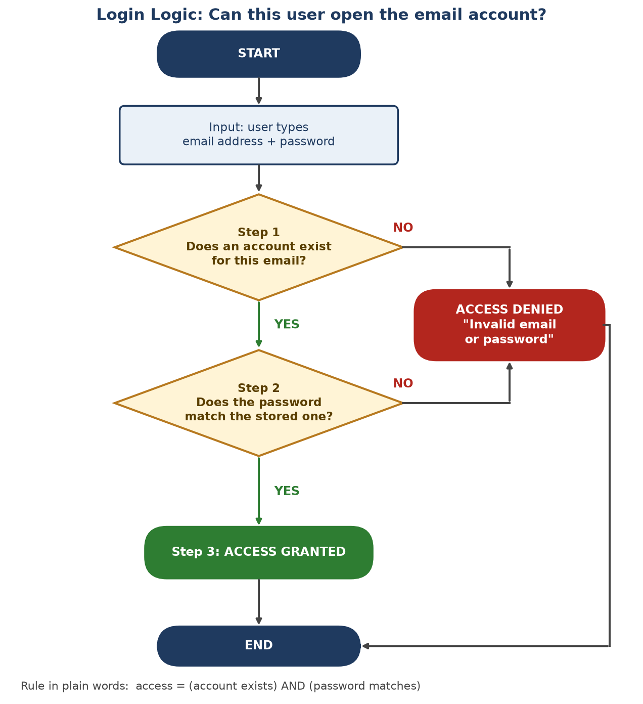

# Topic 1: Introduction to Software and Basic Logic

**Level:** Beginner  |  **Estimated time:** 30 minutes  |  **Status:** Drafted (V1.0 content, revised 31 Oct 2026)
**Comes before:** [Topic 2: Rules and Inference](02-rules-and-inference.md)

**Learning objectives.** After this topic you will be able to:

1. Explain what software is and how it differs from hardware.
2. Define an algorithm and a Boolean condition in your own words.
3. Trace a simple decision (a login check) step by step and check it with a truth table.
4. Write a simple decision as an IF–THEN rule.

---

## 1. Why start here?

The rest of this module is about **Symbolic AI**: AI that works by following rules that people write down. To understand how such a system "thinks", you first need to understand how *any* program makes a decision. This topic gives you that foundation in about half an hour.

---

## 2. Concept explanation

### 2.1 Software and hardware

A computer is a machine. On its own, it does nothing useful. It needs instructions, and those instructions are called **software**.

> **Software:** the instructions (programs) that tell a computer what to do. The word was coined to distinguish these instructions from **hardware**, the physical parts of a computer ([Britannica: Software](https://www.britannica.com/technology/software)).

You cannot touch software. You *can* touch hardware: the screen, the processor chip, the battery, the keyboard.

| Hardware (physical) | Software (instructions) |
|---|---|
| Keyboard, screen, processor, memory chip | Operating system (e.g. Windows, Android) |
| Temperature sensor in a thermostat | The thermostat's control program |
| Phone camera | The camera app |

Two common types of software are **system software**, which runs the computer itself (such as an operating system), and **application software**, which does a task for the user (such as a word processor or email app) ([BBC Bitesize](https://www.bbc.co.uk/bitesize/guides/zcg9kqt/revision/1)).

### 2.2 Computers follow instructions exactly

Computers cannot guess what you meant. They follow instructions exactly, one step at a time, in the order given. If an instruction is vague ("turn the heater on if it's a bit cold"), the computer has no way to ask what "a bit cold" means.

So programmers write instructions as precise, step-by-step procedures.

> **Algorithm:** a step-by-step procedure that solves a problem in a finite number of steps ([Britannica: Algorithm](https://www.britannica.com/science/algorithm)). Each step must be clearly defined, and the procedure must eventually stop.

A recipe is a good everyday comparison: a list of clear steps, in order, with a finished dish at the end. A **program** is an algorithm written in a form a computer can run.

### 2.3 Decisions: true or false

Many steps in an algorithm are **decisions**, for example:

> IF the password is correct, THEN let the user in. OTHERWISE, refuse.

The question "is the password correct?" has only two possible answers: **true** or **false**. A question like this is called a **condition** (or **Boolean condition**).

> **Boolean logic:** a system of logic in which every statement is either true (1) or false (0), and statements are combined with the operators AND, OR and NOT. It is named after the English mathematician George Boole, who first set it out in 1847 ([Britannica: Boolean algebra](https://www.britannica.com/topic/Boolean-algebra)).

| Operator | Meaning | Everyday example | True when… |
|---|---|---|---|
| **AND** | Both parts must be true | "Account exists" AND "password matches" | both are true |
| **OR** | At least one part must be true | "It is raining" OR "it is snowing" | either one (or both) is true |
| **NOT** | Flips the answer | NOT "account is locked" | the account is **not** locked |

> **Truth table:** a table that lists every possible combination of true/false inputs and shows the result for each. It lets you check a rule completely, with no case forgotten ([EBSCO Research Starters: Boolean algebra](https://www.ebsco.com/research-starters/science/boolean-algebra)).

### 2.4 Why this matters for AI

The earliest approach to artificial intelligence, **Symbolic AI**, is built from exactly these pieces. Experts write their knowledge down as many IF–THEN rules, and a program applies those rules automatically ([Britannica: Expert systems](https://www.britannica.com/technology/artificial-intelligence/Expert-systems)). If you understand how one program makes one decision, you already understand the building block of a rule-based AI. Topic 2 shows how many rules are combined.

**Key idea:** Software = precise instructions. Many instructions are true/false decisions. Rule-based AI is built from the same kind of decisions.

---

## 3. Worked example: how does an email app decide whether you may log in?

**Input** (what the program receives): an email address and a password typed by the user.
**Output** (what the program produces): either "open the inbox" or an error message.

**Step 1: Does an account exist for this email?**
The program looks up the email address in its list of accounts.
- Found → the condition is **true**. Continue to Step 2.
- Not found → the condition is **false**. Refuse access.

**Step 2: Does the password match?**
The program compares the typed password with the one stored for that account.
- Match → **true**. Continue to Step 3.
- No match → **false**. Refuse access.

*Note: in well-built systems, passwords are not stored as plain text. They are stored in a scrambled form ("salted and hashed"), and the program compares scrambled versions ([NIST SP 800-63B-4](https://nvlpubs.nist.gov/nistpubs/SpecialPublications/NIST.SP.800-63B-4.pdf)). The true/false logic is the same.*

**Step 3: Decide and respond.**
- If Step 1 AND Step 2 were both true → grant access and open the inbox.
- Otherwise → deny access.

**The whole decision as one Boolean rule:**

```text
access_granted = (account_exists) AND (password_matches)
```

**Checking the rule with a truth table:**

| Account exists? | Password matches? | `account_exists AND password_matches` | Result |
|---|---|---|---|
| True | True | True | **Access granted** |
| True | False | False | Access denied |
| False | True\* | False | Access denied |
| False | False | False | Access denied |

\*In practice a password cannot match an account that does not exist. The row is included because a truth table always shows every combination. Only one row out of four leads to "granted", which is exactly how AND behaves.

**The same logic written as pseudocode.**

> **Pseudocode:** program-like steps written in plain language. It is not a real programming language; it is a way to write an algorithm clearly before (or instead of) coding it.

```text
IF account_exists THEN
    IF password_matches THEN
        show inbox
    ELSE
        show "Invalid email or password"
ELSE
    show "Invalid email or password"
```

**A design detail worth noticing.** Both failure paths show the *same* message. This is deliberate. Security guidance recommends one generic error message whether the email or the password was wrong, so that attackers cannot use the login page to discover which email addresses have accounts ([OWASP Authentication Cheat Sheet](https://cheatsheetseries.owasp.org/cheatsheets/Authentication_Cheat_Sheet.html)). Even this small program is a set of carefully chosen rules.

---

## 4. Visual: the login decision as a flowchart



*Figure 1.1. The login algorithm as a flowchart (added to the repository by @llex-27). Start at the top and follow the arrows. Rounded boxes are the start, end and outcomes; the rectangle is the input; each diamond is one Boolean test with exactly two exits (YES/NO). The only path to "Access granted" answers YES to both questions.*

---

## 5. Learner activity: a thermostat rule

**Scenario.** You are writing the software for a smart thermostat. It has a temperature sensor and can switch a heater ON or OFF.

**Task A (main task).** Write a **3-step algorithm** that turns the heater on when the temperature is below 18 °C. Use the same pattern as the login example:

1. Get the input.
2. Test a true/false condition.
3. Act on the result, using **one IF–THEN–ELSE rule**.

**Task B (truth table).** Fill in the result column for three temperature readings: 15 °C, 18 °C and 21 °C.

**Task C (stretch).** Change your rule so the heater turns on only if the temperature is below 18 °C **and** someone is at home. Which Boolean operator did you use? Write the truth table for the new condition.

*Hints:* "below 18 °C" is a comparison, so it is either true or false for any reading. Decide what the heater should do when the condition is false. Write your answers before reading Section 6.

---

## 6. Expected outcome and answers

### Task A: model answer

| Step | What the software does | Matching step in the login example |
|---|---|---|
| **1. Get the input** | Read the current temperature from the sensor and call it `T`. | The user types an email and password. |
| **2. Test the condition** | Evaluate `T < 18`. The result is **true** or **false**. | "Does the account exist?" / "Does the password match?" |
| **3. Act on the result** | IF `T < 18` is true, THEN switch the heater **ON**; ELSE switch it **OFF**. | Grant or deny access. |

```text
T = read temperature sensor
IF T < 18 THEN
    heater = ON
ELSE
    heater = OFF
```

**Why this is correct:**

- It is an **algorithm**: a short, ordered list of clear steps that finishes with a result. A real thermostat would repeat it every few seconds.
- Step 2 is a **Boolean condition**: `T < 18` can only be true or false, so the program always knows what to do next.
- Step 3 is an **IF–THEN–ELSE rule**. It covers both outcomes, so the heater is never left in an unknown state.

### Task B: truth table

| Reading `T` | `T < 18` | Heater |
|---|---|---|
| 15 °C | True | ON |
| 18 °C | **False** | OFF |
| 21 °C | False | OFF |

The 18 °C row is the one most people get wrong. "Below 18" means *strictly less than* 18, so at exactly 18 °C the condition is false and the heater stays off. If you wrote `T <= 18`, you changed the rule. Computers need this kind of precision.

### Task C: stretch answer

Operator: **AND**. Rule: `IF (T < 18) AND (someone_home) THEN heater = ON ELSE heater = OFF`.

| `T < 18` | `someone_home` | Heater |
|---|---|---|
| True | True | **ON** |
| True | False | OFF |
| False | True | OFF |
| False | False | OFF |

### Common mistakes to check for

1. **Skipping the input step.** The program must read the temperature before it can compare it.
2. **Writing a vague rule** such as "if it's cold, heat it". "Cold" is not a defined true/false condition.
3. **Forgetting the ELSE.** Without it, nothing says what happens when the condition is false.

---

## 7. Check your understanding

1. Is a phone's camera app hardware or software? What about the camera lens?
2. Why is "turn the heater on if it's chilly" *not* a good instruction for a computer?
3. `has_ticket = True`, `ticket_expired = True`. What is the result of `has_ticket AND NOT ticket_expired`?
4. A café gives a discount to customers who are students **or** over 65. Which operator is needed, and does a 70-year-old student get the discount?

**Answers.**
1. The app is software; the lens is hardware.
2. "Chilly" has no exact true/false meaning, so the computer cannot test it. A precise condition such as `T < 18` is needed.
3. `NOT ticket_expired` is False, so `True AND False` = **False**: the person cannot travel.
4. **OR**. Yes: OR is true when at least one part is true, and here both are.

---

## 8. Summary

- **Software** is the set of instructions; **hardware** is the physical machine.
- An **algorithm** is a finite list of clear steps; a program is an algorithm a computer can run.
- Decisions inside algorithms are **Boolean conditions** (true/false), combined with **AND**, **OR** and **NOT**, and checked with **truth tables**.
- An **IF–THEN rule** is the building block of rule-based (Symbolic) AI, which Topic 2 explains.

---

## 9. References

All links accessed on 21 October 2026 and re-checked on 31 October 2026.

1. Encyclopaedia Britannica. *Software.* https://www.britannica.com/technology/software
2. BBC Bitesize. *What is software?* (Computational constructs, National 4). https://www.bbc.co.uk/bitesize/guides/zcg9kqt/revision/1
3. Encyclopaedia Britannica. *Algorithm.* https://www.britannica.com/science/algorithm
4. Encyclopaedia Britannica. *Boolean algebra.* https://www.britannica.com/topic/Boolean-algebra
5. EBSCO Research Starters. *Boolean algebra.* https://www.ebsco.com/research-starters/science/boolean-algebra
6. Encyclopaedia Britannica. *Artificial intelligence: Expert systems.* https://www.britannica.com/technology/artificial-intelligence/Expert-systems
7. Temoshok, D., et al. (2025). *NIST Special Publication 800-63B-4, Digital Identity Guidelines: Authentication and Authenticator Management.* National Institute of Standards and Technology. https://nvlpubs.nist.gov/nistpubs/SpecialPublications/NIST.SP.800-63B-4.pdf
8. OWASP Foundation. *Authentication Cheat Sheet.* https://cheatsheetseries.owasp.org/cheatsheets/Authentication_Cheat_Sheet.html

**Changes from V1.0 (for reviewers):** activity wording now matches the model answer (V1.0 asked for "3 rules" but answered with 3 steps); terms *condition*, *truth table* and *pseudocode* are now defined where they first appear; added a hardware/software table, a truth-table task and a self-check section; removed references that were listed but not used (Britannica Kids, Plus Maths, Stanford Python notes, Crash Course) and replaced a lecture-notes PDF and Wikipedia with Britannica's expert-systems article.
