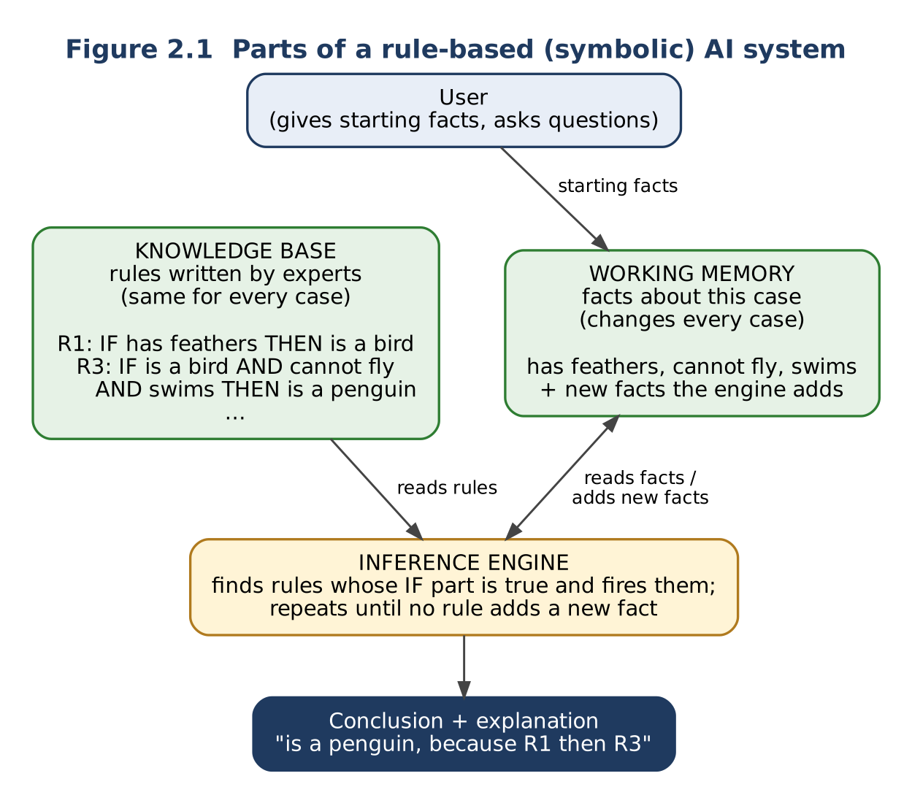
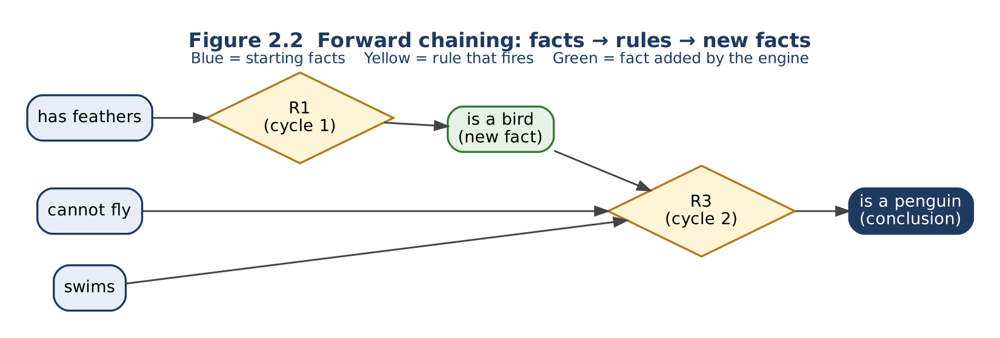

# Topic 2: Rules and Inference: How a Symbolic AI Reasons

**Level:** Beginner  |  **Estimated time:** 45 minutes  |  **Status:** Drafted (fully developed topic; awaiting team review)
**Builds on:** [Topic 1: Software and Basic Logic](01-software-and-logic.md)  |  **Comes before:** [Topic 3: Symbolic AI vs Machine Learning](03-symbolic-ai-vs-machine-learning.md)

**Learning objectives.** After this topic you will be able to:

1. Explain what "symbolic" means in Symbolic AI.
2. Name and describe the parts of a rule-based AI system: facts, rules, knowledge base, working memory and inference engine.
3. Trace **forward chaining** by hand, cycle by cycle, and say when it stops.
4. Explain how the system can answer "why?" by showing the rules it used.
5. Give one real example of an expert system and one important limitation.

---

## 1. From one rule to many

In Topic 1 a program made **one** decision with **one** rule:

```text
IF T < 18 THEN heater = ON ELSE heater = OFF
```

Now imagine a doctor's knowledge about blood infections, written down as **hundreds** of rules like this. A program that stores those rules and applies them automatically to a new patient can give advice that sounds like an expert's. That is the idea behind **Symbolic AI** and its best-known product, the **expert system**.

> **Expert system:** a computer program that uses AI methods to solve problems in one specialised area, the kind of problem that normally needs a human expert ([Britannica: Expert system](https://www.britannica.com/technology/expert-system)).

---

## 2. What does "symbolic" mean?

> **Symbol:** a name or label that stands for something, for example `is a bird`, `has feathers`, `temperature_high`.

Symbolic AI represents knowledge as symbols that humans can read, and reasons by combining those symbols with rules.

One important point: **the computer does not know what the symbols mean.** To the program, `has feathers` is just a string of characters. It does not know that feathers are soft or that birds have them. All the "meaning" comes from the rules people write. For example, the program does not know that `cannot fly` is the opposite of `can fly` unless a rule says so. Keep this in mind; it explains many of the limits in Section 7.

---

## 3. The parts of a rule-based system

| Part | What it is | Everyday comparison |
|---|---|---|
| **Fact** | A statement taken as true for the current case, e.g. `has feathers`. | A clue in a detective story |
| **Rule** | An IF–THEN statement. The **IF part** (also called the *condition* or *antecedent*) is one or more facts joined by AND. The **THEN part** (*conclusion* or *consequent*) is a new fact. | "If the footprints are wet, the suspect came in from outside" |
| **Knowledge base** | The stored collection of rules for one subject area. It is written once, usually with the help of human experts. | The detective's experience |
| **Working memory** | The facts about *this particular case*: the starting facts plus any new facts the system works out. | The detective's notebook |
| **Inference engine** | The program that repeatedly finds rules whose IF part is true and adds their THEN part to working memory. | The detective's reasoning process |

> **Inference:** working out a new fact from facts you already have. Britannica describes an expert system's two basic parts as a knowledge base and an **inference engine** that draws conclusions from it ([Britannica: Expert systems](https://www.britannica.com/technology/artificial-intelligence/Expert-systems)).

> **A rule "fires"** when the inference engine finds that its IF part is true and adds its THEN part to working memory.



*Figure 2.1. The parts of a rule-based system. The knowledge base stays the same for every case; working memory changes for each case. The inference engine is the only part that "does" anything. (Diagram source: `assets/diagram-sources/topic02-expert-system-architecture.dot`.)*

---

## 4. Worked example: an animal identifier

We will build a tiny expert system that identifies an animal from a description. (Small animal-classification systems like this are a standard teaching example; see the frog example in [Wikipedia: Forward chaining](https://en.wikipedia.org/wiki/Forward_chaining).)

### 4.1 The knowledge base (6 rules)

| Rule | IF … | THEN … |
|---|---|---|
| **R1** | has feathers | is a bird |
| **R2** | gives milk | is a mammal |
| **R3** | is a bird AND cannot fly AND swims | is a penguin |
| **R4** | is a bird AND can fly AND hunts at night | is an owl |
| **R5** | is a mammal AND eats meat AND has black stripes | is a tiger |
| **R6** | is a mammal AND has hooves AND has black stripes | is a zebra |

Notice that R3–R6 use facts that are produced by R1 and R2. Rules can build on each other. This is called **chaining**.

### 4.2 The case

A user describes an animal. The starting facts in working memory are:

```text
has feathers,  cannot fly,  swims
```

### 4.3 Forward chaining, step by step

> **Forward chaining:** the inference engine starts from the known facts and keeps firing rules to add new facts, until no rule can add anything new. It is called **data-driven** because the facts decide which rules fire ([Wikipedia: Forward chaining](https://en.wikipedia.org/wiki/Forward_chaining)).

The engine works in **cycles**. In each cycle it checks the rules in order (R1, R2, …), fires the **first** rule whose IF part is completely true **and** whose THEN part is not already known, then starts the next cycle.

**Cycle 1.**
- R1: IF *has feathers*? Yes, it is in working memory → **R1 fires**. Add `is a bird`.

**Cycle 2.** Working memory now: `has feathers, cannot fly, swims, is a bird`.
- R1: IF part true, but `is a bird` is already known → skip (it would add nothing new).
- R2: *gives milk*? Not known → false.
- R3: *is a bird* ✔ AND *cannot fly* ✔ AND *swims* ✔ → **R3 fires**. Add `is a penguin`.

**Cycle 3.**
- R1, R3: true but add nothing new. R2, R4, R5, R6: at least one condition is not known → false.
- No rule can add a new fact → **STOP**.

**Trace table** (the standard way to record forward chaining):

| Cycle | Working memory at start of cycle | Rules with a true IF part that would add something new | Rule fired | New fact |
|---|---|---|---|---|
| 1 | has feathers, cannot fly, swims | R1 | **R1** | is a bird |
| 2 | … + is a bird | R3 | **R3** | is a penguin |
| 3 | … + is a penguin | none | none | **stop** |

**Conclusion:** the animal is a penguin.



*Figure 2.2. The same trace as a picture. Each rule takes facts in and produces one new fact; the new fact from cycle 1 becomes an input in cycle 2.*

### 4.4 Asking "why?": explanations

Because every new fact was added by a named rule, the system can explain its answer by walking back through the chain:

```text
Why "is a penguin"?   Because R3: is a bird AND cannot fly AND swims.
  Why "is a bird"?    Because R1: has feathers.
  "has feathers", "cannot fly", "swims" were given by the user.
```

This is one of the biggest strengths of Symbolic AI. Britannica notes that expert systems can show the sequence of rules behind a conclusion, which helps users judge whether to trust it ([Britannica: Expert system](https://www.britannica.com/technology/expert-system)). The MYCIN medical system, for example, could explain its reasoning on request ([Britannica: Expert systems](https://www.britannica.com/technology/artificial-intelligence/Expert-systems)).

### 4.5 The same idea the other way round: backward chaining

> **Backward chaining:** the engine starts from a **goal** ("Is it a penguin?") and works backwards, checking which facts would be needed to prove it. It is called **goal-driven** ([Wikipedia: Forward chaining](https://en.wikipedia.org/wiki/Forward_chaining)).

Goal: *is a penguin?*
1. Which rule concludes `is a penguin`? **R3**. So we need: `is a bird`, `cannot fly`, `swims`.
2. `is a bird`: not given, but **R1** concludes it if `has feathers`. Is `has feathers` known? Yes ✔.
3. `cannot fly`: known ✔. `swims`: known ✔.
4. All conditions are proved → goal is **true**.

If a needed fact is not known, a backward-chaining system can **ask the user** ("Does the animal swim?"). This is how many diagnosis systems hold a conversation: they ask only the questions that matter for the goal they are testing.

| | Forward chaining | Backward chaining |
|---|---|---|
| Starts from | Facts | A goal (a hypothesis) |
| Question it answers | "What can I conclude from these facts?" | "Is this particular conclusion true?" |
| Good for | Monitoring, configuration, "what follows?" | Diagnosis, "is it X?", asking targeted questions |

### 4.6 Optional: watch a computer do it

The file [`examples/topic02_mini_rule_engine.py`](../examples/topic02_mini_rule_engine.py) contains the same six rules and a 20-line inference engine. Running it prints exactly the trace above:

```text
Starting facts: has feathers, cannot fly, swims

Cycle 1: R1 fires because has feathers -> add 'is a bird'
Cycle 2: R3 fires because is a bird AND cannot fly AND swims -> add 'is a penguin'
Cycle 3: no rule adds a new fact -> STOP

Why is it a penguin?
- 'is a penguin' because of R3 (IF is a bird AND cannot fly AND swims)
    - 'is a bird' because of R1 (IF has feathers)
        - 'has feathers' was given as a starting fact
    - 'cannot fly' was given as a starting fact
    - 'swims' was given as a starting fact
```

You do not need to read Python for this module. The point is that the computer's "reasoning" is nothing more than the loop you just did by hand.

---

## 5. Learner activity

Use the knowledge base in Section 4.1 (R1–R6) and the same strategy: in each cycle, fire the first rule (in order R1→R6) whose IF part is true and whose THEN part is new.

**Part A: trace it.** The starting facts are: `gives milk`, `has hooves`, `has black stripes`. Complete a trace table (cycle, working memory, rule fired, new fact). What does the system conclude, and in which cycle does it stop?

**Part B: extend the knowledge base.** Write one new rule, R7, that identifies a **giraffe**, using `is a mammal` plus two other facts of your choice. Then write the starting facts a user would need to give for R7 to fire.

**Part C: backward chaining.** The goal is *"is a tiger?"*. Which facts would the system need to check, and in what order? Which question would it ask the user if it knew only `gives milk`?

**Part D: find the gap.** A user enters `has feathers` and `can fly`. What does the system conclude? Is that a mistake by the computer, or a limit of the knowledge base? Explain in one or two sentences.

---

## 6. Expected outcomes and answers

### Part A

| Cycle | Working memory at start | Rule fired | New fact |
|---|---|---|---|
| 1 | gives milk, has hooves, has black stripes | **R2** (gives milk) | is a mammal |
| 2 | … + is a mammal | **R6** (is a mammal AND has hooves AND has black stripes) | is a zebra |
| 3 | … + is a zebra | none | **stop** |

**Conclusion: zebra**, stopping in cycle 3. R5 (tiger) does **not** fire, because `eats meat` is not in working memory, even though two of its three conditions are true. AND needs *every* condition to be true (Topic 1).
*You can check this answer by changing the starting facts in the example program.*

### Part B (one possible answer)

```text
R7: IF is a mammal AND has a very long neck AND has hooves THEN is a giraffe
Starting facts needed: gives milk, has a very long neck, has hooves
```

Any rule is acceptable if (1) it includes `is a mammal`, (2) the conditions are clear true/false facts, and (3) the starting facts include `gives milk`. Without it, R2 cannot produce `is a mammal`, and R7 can never fire.
**Watch out:** if your giraffe rule used `has black stripes`, the same facts might also fire R6 and the system would conclude "zebra" too. Rules can conflict, which is why rule writers must check new rules against old ones.

### Part C

1. The goal `is a tiger` is concluded only by **R5**, so the system needs `is a mammal`, `eats meat` and `has black stripes`.
2. `is a mammal` comes from **R2**, which needs `gives milk`. It is known ✔.
3. `eats meat` is not known, so the system would **ask: "Does the animal eat meat?"** (then "Does it have black stripes?").

The system asks only about facts that matter for the goal. It would never ask about feathers, because no step towards "tiger" needs them.

### Part D

Cycle 1: R1 fires → `is a bird`. Cycle 2: no rule adds anything new → stop. The system concludes only **"is a bird"**, not which bird. R4 (owl) needs `hunts at night` as well, and no rule covers other flying birds.

This is **not** a computer error. The engine did exactly what the rules say. It is a **gap in the knowledge base**: the system knows only what its rules cover. This is the main weakness of rule-based systems, explored in Section 7 and in Topic 4.

### Common mistakes

1. Firing a rule when only *some* of its AND conditions are true (e.g. firing R5 in Part A).
2. Firing the same rule again and again. A rule that adds nothing new does not count.
3. Forgetting that new facts (like `is a mammal`) can make other rules true in the *next* cycle.

---

## 7. Real expert systems, and their limits

| System | When / where | What it did | Source |
|---|---|---|---|
| **DENDRAL** | From 1965, Stanford University (Feigenbaum and Lederberg) | Suggested the molecular structure of chemical compounds from spectrograph data; often called the first expert system | [Britannica: Expert systems](https://www.britannica.com/technology/artificial-intelligence/Expert-systems) |
| **MYCIN** | From 1972, Stanford University | Diagnosed blood infections and recommended treatment using about 500 rules; could explain its reasoning; performed about as well as specialists and better than general practitioners | [Britannica: Expert systems](https://www.britannica.com/technology/artificial-intelligence/Expert-systems) |
| **XCON (R1)** | Built 1978 by John McDermott (Carnegie Mellon) for Digital Equipment Corporation; in use from 1980 | Chose the components for customers' computer orders; grew to about 2,500 rules; estimated to save the company about $25 million a year | [Wikipedia: XCON](https://en.wikipedia.org/wiki/Xcon) |

**Strengths**
- **Explainable:** every conclusion can be traced to named rules (Section 4.4).
- **Uses expert knowledge directly:** no large dataset is needed, only experts willing to state their rules.
- **Predictable:** the same facts always give the same answer.

**Limits**
- **No common sense, no awareness of its own limits.** Britannica gives a striking example: told that a patient was bleeding heavily from a gunshot wound, MYCIN would still try to find a bacterial cause, because bacteria were all its rules knew about ([Britannica: Expert systems](https://www.britannica.com/technology/artificial-intelligence/Expert-systems)).
- **Knows only what its rules cover**, as Part D showed. Anything unexpected is either missed or handled wrongly. Systems that fail like this outside their narrow area are often called **brittle**.
- **Hard to maintain.** Every new situation needs new rules, and new rules can conflict with old ones (Part B's warning). XCON needed thousands of rules.
- **Uncertainty is hard.** Real expert knowledge is rarely 100% certain, so real systems attached confidence or probability values to rules ([Britannica: Expert system](https://www.britannica.com/technology/expert-system)). Our simple true/false version leaves this out.

These limits are a large part of why interest in rule-only AI collapsed in the late 1980s (Topic 4), and why most modern AI learns from data instead (Topic 3).

---

## 8. Check your understanding

1. Which part of an expert system changes for every new case: the knowledge base or working memory?
2. In forward chaining, when does the inference engine stop?
3. A rule is `IF A AND B THEN C`. Working memory contains `A` only. Does the rule fire?
4. A doctor wants to test one suspected illness by asking the patient only relevant questions. Forward or backward chaining?
5. Give one reason why an expert system's answer may be easier to trust than an answer with no explanation.

**Answers.**
1. **Working memory.** The knowledge base (rules) stays the same.
2. When a full cycle passes in which **no rule can add a new fact**.
3. **No.** AND requires both A and B to be true.
4. **Backward chaining.** It starts from a goal and asks only for the facts needed to prove it.
5. It can show the exact rules it used, so a human expert can check each step (Section 4.4).

---

## 9. Summary

- **Symbolic AI** stores knowledge as human-readable **symbols** and **IF–THEN rules**. The computer does not understand the symbols; all meaning comes from the rules.
- A rule-based system has a **knowledge base** (rules), **working memory** (facts for this case) and an **inference engine** (the loop that fires rules).
- **Forward chaining** goes from facts to conclusions until nothing new can be added; **backward chaining** starts from a goal and works back to the facts.
- Rule-based systems can **explain** every conclusion, but they are **brittle**: they know only what their rules cover.

---

## 10. References

Links accessed 31 October 2026.

1. Encyclopaedia Britannica. *Expert system.* https://www.britannica.com/technology/expert-system
2. Encyclopaedia Britannica. *Artificial intelligence: Expert systems* (sections on knowledge base and inference engine, DENDRAL, MYCIN, and limitations). https://www.britannica.com/technology/artificial-intelligence/Expert-systems
3. Wikipedia. *Forward chaining* (definition; data-driven vs goal-driven; frog example). https://en.wikipedia.org/wiki/Forward_chaining
4. Wikipedia. *Xcon* (R1/XCON development, rule count, reported savings). https://en.wikipedia.org/wiki/Xcon

**Further reading (not used for specific claims):**

- Microsoft. *AI for Beginners, Lesson 2: Knowledge Representation and Expert Systems.* https://github.com/microsoft/AI-For-Beginners/blob/main/lessons/2-Symbolic/README.md
- Russell, S. and Norvig, P. (2021). *Artificial Intelligence: A Modern Approach* (4th ed.), Pearson. Chapters on logical agents and inference. *(Standard university textbook; team to confirm chapter numbers from the library copy.)*

**Note on sources:** Wikipedia is used only for the general definition of forward/backward chaining and for XCON figures, which are not covered in Britannica. Reviewers should confirm the XCON figures against a second source (see `docs/review-log.md`).
