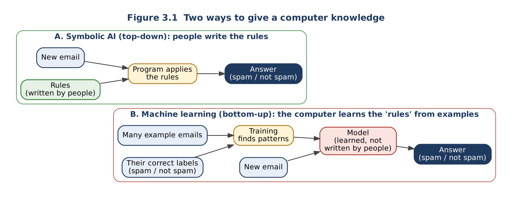

# Topic 3: Symbolic AI vs Machine Learning

**Level:** Beginner  |  **Estimated time:** 30 minutes  |  **Status:** Drafted (awaiting team review)
**Builds on:** [Topic 2: Rules and Inference](02-rules-and-inference.md)  |  **Comes before:** [Topic 4: History](04-history-and-ai-winters.md)

**Learning objectives.** After this topic you will be able to:

1. Describe the difference between writing rules (symbolic AI) and learning from examples (machine learning).
2. Compare the two approaches on explainability, data needed, flexibility and maintenance.
3. Choose a suitable approach for a simple problem and justify the choice.

---

## 1. Two ways to give a computer knowledge

In Topic 2, **people** wrote every rule. The computer only applied them. This is sometimes called a **top-down** approach: knowledge flows from human experts down into the program.

There is a second way. Instead of writing the rules, you give the computer **many examples together with the correct answers**, and a program finds the patterns itself.

> **Machine learning (ML):** a branch of AI in which software learns patterns from data rather than following rules that a programmer wrote in advance ([Britannica: Machine learning](https://www.britannica.com/technology/machine-learning); [IBM Developer: What is machine learning?](https://developer.ibm.com/articles/what-is-machine-learning/)).

> **Training:** the process in which an ML program studies example data to find patterns.
> **Model:** the result of training, the learned "rules", stored as numbers rather than as readable IF–THEN statements.
> **Labelled data:** examples that come with their correct answer, e.g. emails each marked "spam" or "not spam".

This is a **bottom-up** approach: knowledge is built up from the data.



*Figure 3.1. In symbolic AI, people supply the rules. In machine learning, people supply examples and answers, and the computer produces the model. Both end up answering new questions.*

---

## 2. Same problem, two approaches: a spam filter

**Symbolic version.** A programmer writes rules:

```text
R1: IF subject contains "FREE MONEY" THEN spam
R2: IF sender is in the user's contacts THEN not spam
R3: IF email contains more than 5 links AND sender is unknown THEN spam
```

- ✔ Easy to explain: "This was marked spam because of R1."
- ✘ Spammers quickly write "FR3E M0NEY", and R1 no longer matches. Someone must keep writing new rules.

**Machine-learning version.** The team collects, say, 100,000 emails that users have already marked as spam or not spam, and trains a model on them.

- ✔ The model picks up patterns no one thought to write down, and can be retrained on new spam.
- ✘ It needs a lot of labelled data. It is hard to explain exactly *why* a particular email was blocked, because the "rules" are thousands of learned numbers.

*(These two filters are simplified teaching examples, not descriptions of a specific product. Real email services combine both approaches.)*

---

## 3. Comparison

| Question | Symbolic AI (rules) | Machine learning |
|---|---|---|
| Where does the knowledge come from? | Human experts write it as rules | Patterns found in example data |
| What does it need to get started? | Experts who can state their rules | Large amounts of (usually labelled) data |
| Can it explain an answer? | **Yes**: it lists the rules that fired (Topic 2, §4.4) | **Often difficult**: the model is many numbers |
| What happens with an unusual case? | Fails if no rule covers it ("brittle") | May handle it if similar examples were in the data; may also be confidently wrong |
| How is it updated? | People edit or add rules | Retrain on new data |
| Good fit | Clear, stable rules; answers must be justified (law, eligibility, safety checks) | Patterns too complex to write down (recognising faces, speech, handwriting) |

**Key idea:** neither approach is "better" in general. Symbolic AI is strong where rules are clear and explanations matter; machine learning is strong where rules are too many or too vague to write by hand. Topic 5 shows that many modern systems use **both**.

---

## 4. Learner activity: which approach fits?

For each scenario, choose **symbolic AI**, **machine learning**, or **both**, and give one reason.

1. Checking whether a student meets the published entry requirements for a course (minimum grades in named subjects).
2. Recognising which animal is in a photo.
3. Calculating income tax from salary using the government's published tax bands.
4. Recommending songs based on what millions of users have listened to.
5. A hospital system that reads X-ray images **and** must flag any result that breaks a fixed safety guideline.

---

## 5. Expected outcomes and answers

| # | Best fit | Reason |
|---|---|---|
| 1 | **Symbolic** | The requirements are explicit, published rules, and the decision must be explainable to the applicant. |
| 2 | **Machine learning** | No one can write IF–THEN rules for every possible photo of every animal; the patterns are learned from many labelled images. |
| 3 | **Symbolic** | Tax bands are exact rules set by law; using ML would add error and remove the explanation. |
| 4 | **Machine learning** | Taste patterns across millions of users are too complex to write down, and data is plentiful. |
| 5 | **Both** | ML is suited to reading images; the fixed guideline is a clear rule that should be checked by rules and explained. |

Accept other answers if the reason refers to the comparison criteria in Section 3 (clear rules? explanation needed? enough data?).

---

## 6. Summary

- **Symbolic AI:** people write the rules (top-down); explainable, but brittle and hard to maintain.
- **Machine learning:** the computer learns patterns from labelled examples (bottom-up); flexible, but data-hungry and harder to explain.
- The right choice depends on whether the rules are clear, whether explanations are required, and whether enough data exists.

---

## 7. References

Links accessed 31 October 2026.

1. Encyclopaedia Britannica. *Machine learning.* https://www.britannica.com/technology/machine-learning
2. IBM Developer. *What is machine learning?* (contrasts rule-based programming with learning from data). https://developer.ibm.com/articles/what-is-machine-learning/
3. Encyclopaedia Britannica. *Artificial intelligence: Expert systems.* https://www.britannica.com/technology/artificial-intelligence/Expert-systems

**Gaps for review:** the spam-filter example is our own illustration and should be checked by a reviewer for accuracy. Section 3's comparison is a simplification; a reviewer should confirm that none of the rows is misleading for beginners.
