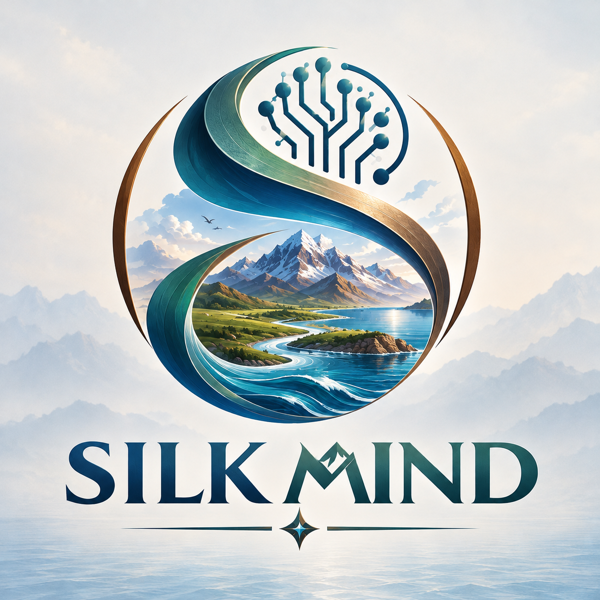

# SilkMind: Software & Symbolic AI

A beginner's learning module on **how software makes decisions and how rule-based (symbolic) AI reasons**: where it succeeded, where it failed, and where it is used today. This repository holds the shared Markdown content that our **Study Guide and Test Bank**, **PPT Slides** and **Video Tutorials** are built from.

**Current version:** Markdown Content **V2.0** (Stage 2), 3 November 2026  |  **Readable copy:** [`pdf/SilkMind_Learning_Content_V2.0.pdf`](pdf/SilkMind_Learning_Content_V2.0.pdf)

---

## Team

| Member | GitHub | Role |
|---|---|---|
| Afandiyeva Hayat | [@afandiyevahayat](https://github.com/afandiyevahayat) | Team lead (CEO) |
| Khaydarov Sarvarbek | [@skh0035](https://github.com/skh0035) | Repository & information lead (CIO) |
| Nabizadehshahrbabak Arsalan | [@ArsalanVayu](https://github.com/ArsalanVayu) | Quality lead (reviews and merges pull requests) |
| Egemberdiyeva Aliya | [@All886](https://github.com/All886) | Content lead |
| Kenzhebolat Anel | [@anlinavie](https://github.com/anlinavie) | Visual design & video lead |
| Mukhtarov Mukhammadshakhruz | [@llex-27](https://github.com/llex-27) | Visual design lead |
| Bakatov Madi | [@madi67-rgb](https://github.com/madi67-rgb) | Video lead |

*Student ID numbers are kept in the private submission report, not in this public repository.*

---

## Purpose and intended learners

**Purpose.** To give complete beginners a clear, connected path from "how does a program decide anything?" to "how does a rule-based AI reason, how is that different from machine learning, why did it rise and fall, and where is it used today?"

**Intended learners.** First-year university students from any subject, with no programming, computer-science or AI background. Everyday computer use and basic comparisons (`<`, `>`) are the only prerequisites; see the [module outline](content/00-module-outline.md#1-who-this-module-is-for).

---

## Where to find things

*This block is generated automatically from the files in the repository (`scripts/update_readme_tree.py`, run on every pull request). Do not edit it by hand; add descriptions in `.github/tree-comments.json`.*

<!-- TREE:START -->
```text
├── 📁 assets/                                        # Images used by the content
│   ├── 📁 diagram-sources/                           # Editable sources for every diagram
│   │   ├── 📄 topic02-expert-system-architecture.dot
│   │   ├── 📄 topic02-forward-chaining.dot
│   │   ├── 📄 topic03-rules-vs-learning.dot
│   │   └── 📄 topic04_timeline.py
│   ├── 🖼️ silkmind-logo.png                          # Team logo
│   ├── 🖼️ topic01-login-flowchart.png                # Figure 1.1
│   ├── 🖼️ topic02-expert-system-architecture.png     # Figure 2.1
│   ├── 🖼️ topic02-forward-chaining.png               # Figure 2.2
│   ├── 🖼️ topic03-rules-vs-learning.png              # Figure 3.1
│   └── 🖼️ topic04-ai-timeline.png                    # Figure 4.1
├── 📁 content/                                       # THE LEARNING CONTENT (read 00 → 06 in order)
│   ├── 📄 00-module-outline.md                       # Module Outline: Software & Symbolic AI
│   ├── 📄 01-software-and-logic.md                   # Topic 1: Introduction to Software and Basic Logic
│   ├── 📄 02-rules-and-inference.md                  # Topic 2: Rules and Inference (core topic)
│   ├── 📄 03-symbolic-ai-vs-machine-learning.md      # Topic 3: Symbolic AI vs Machine Learning
│   ├── 📄 04-history-and-ai-winters.md               # Topic 4: History: The Rise, the AI Winters and the Lessons
│   ├── 📄 05-symbolic-ai-in-modern-software.md       # Topic 5: Symbolic AI in Modern Software
│   ├── 📄 06-test-bank.md                            # Module Test Bank
│   └── 📄 glossary.md                                # Glossary
├── 📁 docs/                                          # Project management (no personal logs)
│   ├── 📄 ai-use-log.md                              # Project-level record of AI assistance
│   ├── 📄 changelog.md                               # What changed in each version
│   ├── 📄 project-plan-designed.pdf                  # Designed Stage 1 plan
│   ├── 📄 project-plan.md                            # Plan, task list, owners, deadlines
│   ├── 📄 resource-mapping.md                        # Markdown → Study Guide / slides / videos
│   ├── 📄 review-log.md                              # Peer reviews, learner tests, production fixes
│   └── 📄 revision-summary.md                        # Stage 1 → Stage 2 changes (for the report)
├── 📁 examples/                                      # Optional runnable demos (Python 3, no packages)
│   ├── 📄 topic02_mini_rule_engine.py                # Topic 2: forward chaining + explanations
│   └── 📄 topic03_learn_a_rule.py                    # Topic 3: learning a threshold rule from data
├── 📁 pdf/                                           # Rendered, readable copy of all content
│   └── 📄 SilkMind_Learning_Content_V2.0.pdf         # Readable copy: outline, Topics 1–5, test bank, glossary
├── 📁 scripts/                                       # Repository automation
│   └── 📄 update_readme_tree.py                      # Regenerates the structure block in this README
└── 📄 README.md                                      # You are here
```
<!-- TREE:END -->

All images use **relative paths** (e.g. `../assets/topic02-forward-chaining.png`), so the content renders correctly in a downloaded copy as well as on GitHub.

---

## Content status

| File | What it covers | Status |
|---|---|---|
| [`00-module-outline.md`](content/00-module-outline.md) | Outcomes, sequence, status of every subtopic, known gaps | Drafted V2.0 |
| [`01-software-and-logic.md`](content/01-software-and-logic.md) | Software, algorithms, Boolean conditions, IF–THEN rules | Drafted V2.0 |
| [`02-rules-and-inference.md`](content/02-rules-and-inference.md) | Knowledge base, inference engine, forward/backward chaining, expert systems | Drafted V2.0 (core topic) |
| [`03-symbolic-ai-vs-machine-learning.md`](content/03-symbolic-ai-vs-machine-learning.md) | Writing rules vs learning them from data; worked learning example | Drafted V2.0 |
| [`04-history-and-ai-winters.md`](content/04-history-and-ai-winters.md) | Dartmouth to the second AI winter; why rule-only AI hit its limits | Drafted V2.0 |
| [`05-symbolic-ai-in-modern-software.md`](content/05-symbolic-ai-in-modern-software.md) | Forms, decision tables, game AI, knowledge graphs, neuro-symbolic AI | Drafted V2.0 |
| [`06-test-bank.md`](content/06-test-bank.md) | 25 questions mapped to all 7 learning outcomes, with answers | Drafted V2.0 |
| [`glossary.md`](content/glossary.md) | One definition per term, used in every resource | Drafted V2.0 |

**Status labels:** Outline only → Drafted → **Checked** (or Needs revision). A file becomes *Checked* only after a member who did not write it records a review in [`docs/review-log.md`](docs/review-log.md). Every topic has a worked example, a visual, activities with answers (including find-the-error and predict tasks) and a "common misunderstandings" section.

---

## Project plan and task list

The Stage 2 task list, with owners, reviewers and deadlines, is in [`docs/project-plan.md`](docs/project-plan.md). How each Markdown section feeds the Study Guide, slides and videos is in [`docs/resource-mapping.md`](docs/resource-mapping.md).

**How we work on GitHub**
- Each member works on a branch and opens a **pull request**; another member reviews it before the Quality lead merges.
- Commit messages say *what changed and why*, e.g. `Topic 4: correct Fifth Generation dates to 1982–1992 (IPSJ, Nature 1992)`.
- Errors found while making slides or videos are fixed **here first**, then in every resource (see `docs/resource-mapping.md`).

---

## Current progress and remaining work

**Done (as of 3 Nov 2026)**
- All five topics drafted at full depth: explanations, defined terms, worked examples, eight figures and tables, activities with checked answers, misconceptions, references.
- Test bank (25 questions) and glossary; two runnable demos whose output matches every tracing answer.
- Revision of Stage 1 problems: see [`docs/revision-summary.md`](docs/revision-summary.md).
- Facts re-checked against second sources; one date error (Fifth Generation project) and one answer error (Topic 3 Activity A) found and corrected.

**Remaining before the Stage 2 deadline (7 Nov)**
1. Each author of record reviews, revises and commits their topic under their own account.
2. Peer reviews and learner tests recorded in `docs/review-log.md`; then status → *Checked*.
3. Second sources for the remaining single-source history facts (listed in `docs/review-log.md` §3).
4. Study Guide, slides and videos built from this content; mapping updated with real slide numbers.
5. Final PDF render, ZIP, and submission report.

AI assistance is recorded in [`docs/ai-use-log.md`](docs/ai-use-log.md).
