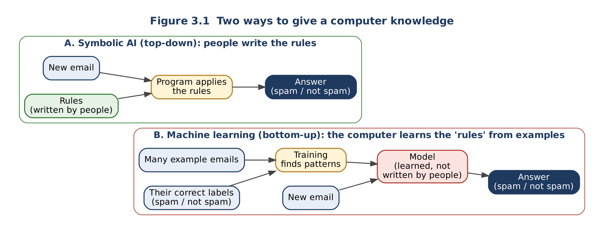

# Topic 3: Symbolic AI vs Machine Learning

**Level:** Beginner  |  **Estimated time:** 40 minutes  |  **Status:** Drafted V2.0 (awaiting peer review)
**Builds on:** [Topic 1](01-software-and-logic.md) (conditions, truth tables) and [Topic 2](02-rules-and-inference.md) (rules, knowledge base)  |  **Comes before:** [Topic 4: History](04-history-and-ai-winters.md)

**Learning objectives.** After this topic you will be able to:

1. Describe the difference between **writing rules** (symbolic AI) and **learning from examples** (machine learning).
2. Trace, by hand, how a very simple machine-learning program "learns" a rule from labelled data.
3. Compare the two approaches on explainability, data needed, handling of unusual cases, and maintenance.
4. Choose a suitable approach for a problem and justify the choice.

---

## 1. Two ways to give a computer knowledge

In Topic 2, **people** wrote every rule (R1–R6). The computer only applied them. This is called a **top-down** approach: knowledge flows from human experts down into the program.

There is a second way. Instead of writing the rules, you give the computer **many examples together with the correct answers**, and a program finds the pattern itself. This is a **bottom-up** approach: the knowledge is built up from data.

> **Machine learning (ML):** a branch of AI in which software learns patterns from data, instead of following rules that a programmer wrote in advance ([Britannica: Machine learning](https://www.britannica.com/technology/machine-learning); [IBM Developer: What is machine learning?](https://developer.ibm.com/articles/what-is-machine-learning/)).

| Term | Meaning | In the spam example below |
|---|---|---|
| **Labelled data** | Examples that each come with the correct answer (the **label**) | 10 emails, each marked "spam" or "not spam" |
| **Feature** | A measurable property of an example that the program is allowed to look at | The number of links in the email |
| **Training** | The process in which an ML program searches for the pattern that best fits the labelled data | Trying different rules and counting mistakes |
| **Model** | The result of training; the learned "rule", used to answer new cases | `IF links >= 4 THEN spam` |
| **Prediction** | The model's answer for a new, unlabelled example | Email K (7 links) → spam |



*Figure 3.1. In symbolic AI, people supply the rules. In machine learning, people supply examples and answers, and training produces the model. Both then answer new questions.*

---

## 2. Same problem, two approaches: a spam filter

**Symbolic version.** A programmer writes the rules:

```text
R1: IF subject contains "FREE MONEY" THEN spam
R2: IF sender is in the user's contacts THEN not spam
R3: IF email contains more than 5 links AND sender is unknown THEN spam
```

- ✔ Easy to explain: "This was marked spam because of R1."
- ✘ Spammers quickly write "FR3E M0NEY", and R1 no longer matches. Someone must keep writing new rules.

**Machine-learning version.** The team collects emails that users have already marked as spam or not spam, and lets a program find the pattern. Section 3 shows, in a tiny version you can do by hand, what "finding the pattern" means.

*(Both filters here are simplified teaching examples, not descriptions of a specific product. Real email services combine many techniques.)*

---

## 3. Worked example: watching a computer "learn" a rule

Real ML models look at thousands of features at once and are trained with mathematics beyond this module. But the **core idea**, *try possible rules and keep the one that makes the fewest mistakes on the labelled examples*, can be shown with one feature and ten emails.

### 3.1 The labelled training data

| Email | A | B | C | D | E | F | G | H | I | J |
|---|---|---|---|---|---|---|---|---|---|---|
| Number of links | 0 | 1 | 1 | 2 | 3 | 2 | 4 | 5 | 6 | 8 |
| Label (correct answer) | not | not | not | not | not | **spam** | **spam** | **spam** | **spam** | **spam** |

Notice that the data is **not perfect**: email F is spam with only 2 links, while email E is genuine with 3 links. Real data is always a bit messy like this.

### 3.2 The kind of rule the program is allowed to learn

We let the program learn **one** rule of this shape, where `k` is a number it must choose:

```text
IF number_of_links >= k THEN spam ELSE not spam
```

Choosing `k` is the whole "training". (This shape is a **threshold rule**: everything at or above the threshold is classed as spam.)

### 3.3 Training: try each k and count mistakes

**Step 1: try k = 2.** The rule says "2 or more links → spam".

| Email | Links | Rule predicts | Correct label | Mistake? |
|---|---|---|---|---|
| A, B, C | 0, 1, 1 | not | not | – |
| D | 2 | **spam** | not | ✘ |
| E | 3 | **spam** | not | ✘ |
| F | 2 | spam | spam | – |
| G, H, I, J | 4–8 | spam | spam | – |

k = 2 makes **2 mistakes** (D and E).

**Step 2: repeat for every k.** Doing the same check for each value gives:

| k | 0 | 1 | 2 | 3 | **4** | 5 | 6 | 7 | 8 | 9 |
|---|---|---|---|---|---|---|---|---|---|---|
| Mistakes (out of 10) | 5 | 4 | 2 | 2 | **1** | 2 | 3 | 4 | 4 | 5 |

**Step 3: keep the best.** k = 4 makes the fewest mistakes (only email F is wrong), so the learned model is:

```text
IF number_of_links >= 4 THEN spam ELSE not spam
```

**Nobody wrote this rule.** The number 4 came from the data. If the data changed, retraining would choose a different k.

### 3.4 Using the model on new emails (prediction)

| New email | Links | Prediction |
|---|---|---|
| K | 7 | spam |
| L | 0 | not spam |
| M | 3 | not spam |

### 3.5 What this example shows, and what it hides

- **Shows:** the computer chose the rule, by measuring mistakes on labelled examples. This is the bottom-up idea.
- **Shows:** the model is **not perfect** even on its own training data (F is still wrong), and it can be wrong on new emails too.
- **Hides:** real models use many features (words, sender, time, …) and millions of examples, and the learned "rule" is stored as thousands or millions of numbers. That is why real models are hard to explain, even though the idea is the same.

**Optional:** [`examples/topic03_learn_a_rule.py`](../examples/topic03_learn_a_rule.py) runs this exact training and prints the same mistakes table and predictions.

---

## 4. Comparison

| Question | Symbolic AI (rules) | Machine learning |
|---|---|---|
| Where does the knowledge come from? | Human experts write it as rules | Patterns found in labelled example data |
| What does it need to get started? | Experts who can state their rules clearly | Enough relevant, correctly labelled data |
| Can it explain an answer? | **Yes**: it lists the rules that fired (Topic 2, §4.4) | **Often difficult**: real models are many numbers. Our one-feature model is explainable only because it is tiny |
| What happens with an unusual case? | Fails if no rule covers it ("brittle", Topic 2 Activity D) | May handle it if similar examples were in the data; may also be **confidently wrong** |
| How is it updated? | People edit or add rules | Collect new data and retrain |
| Good fit | Clear, stable rules; answers must be justified (eligibility, regulations, safety checks) | Patterns too complex to write down (recognising images, speech, handwriting) |

**Key idea:** neither approach is better in general. Symbolic AI is strong where rules are clear and explanations matter. Machine learning is strong where the rules are too many or too vague to write by hand **and** good data exists. Topic 5 shows systems that use **both**.

---

## 5. Common misunderstandings

| Misunderstanding | Why it is wrong |
|---|---|
| "Machine learning means the computer understands the data." | It finds patterns that reduce mistakes. In §3 the program never knew what a "link" or "spam" is, just as the symbolic system in Topic 2 never knew what a feather is. |
| "A learned model is always right because it learned from real data." | Our model is wrong on email F, and a model can only be as good as its data. If the labels are wrong or the examples are unrepresentative, the model learns the wrong pattern. |
| "Symbolic AI is old and has been replaced by machine learning." | Rule-based systems are still widely used where exact, explainable rules are required (Topic 5). Many modern systems combine both. |
| "ML doesn't use rules at all." | A model *is* a kind of rule (in §3, literally a threshold rule). The difference is **who writes it**: a person, or a training process. |

---

## 6. Learner activities

**Activity A: retrain the model (trace).** A new labelled email arrives: **N, 3 links, spam**. Add it to the training data (now 11 emails) and recompute the mistakes for k = 2, 3, 4 and 5. Which k is best now? What does this tell you about models and data?

**Activity B: predict and explain.** Using the original model (`links >= 4`), predict email P (12 links). It is actually a genuine newsletter from the user's university. Is the prediction right? Would rule R2 from §2 have handled it better? Why?

**Activity C: choose an approach.** For each scenario, choose **symbolic AI**, **machine learning**, or **both**, and give a reason based on the comparison table in §4.

1. Checking whether a student meets the published entry requirements for a course (minimum grades in named subjects).
2. Recognising which animal is in a photo.
3. Calculating a delivery fee from a published price list (distance bands and weight bands).
4. Recommending songs based on what millions of users have listened to.
5. A hospital system that reads X-ray images **and** must flag any result that breaks a fixed safety guideline.

**Activity D: find the error.** A classmate writes: *"Our spam model learned `links >= 4`. Since it made only 1 mistake out of 10, it will be about 90% correct on every future email."* Identify the flaw in this reasoning.

---

## 7. Expected outcomes and answers

### Activity A

With N (3 links, spam) added:

| k | Mistakes | Which emails are wrong |
|---|---|---|
| 2 | **2** | D (2, not → predicted spam), E (3, not → predicted spam) |
| 3 | **2** | E (3, not → predicted spam), F (2, spam → predicted not) |
| 4 | **2** | F, N (both spam, predicted not) |
| 5 | 3 | F, G, N |

k = 2, 3 and 4 now **tie** with 2 mistakes each, and k = 4 is no longer the clear winner. (The demo program picks the smallest k on a tie, so it would now learn `links >= 2`.) The lesson: **the learned rule depends on the data**, and one new example can change the model. Ties also show that training needs a rule for choosing between equally good options. In symbolic AI, by contrast, the rule changes only when a person edits it.

*Check:* add `("N", 3, "spam")` to `TRAINING` in the example program and run it.

### Activity B

The model predicts **spam** (12 ≥ 4), which is **wrong**. It only looks at the number of links and has never seen a "trusted sender" feature. Rule R2 (`IF sender is in the user's contacts THEN not spam`) would handle it correctly *if* the university address is in the contacts. This shows why real systems often combine learned patterns with explicit rules (Topic 5).

### Activity C

| # | Best fit | Reason |
|---|---|---|
| 1 | **Symbolic** | The requirements are explicit, published rules, and the decision must be explainable to the applicant. |
| 2 | **Machine learning** | No one can write rules for every possible photo; the patterns are learned from many labelled images. |
| 3 | **Symbolic** | A published price list is exact rules; ML would add errors and remove the explanation. |
| 4 | **Machine learning** | Listening patterns across millions of users are too complex to write down, and data is plentiful. |
| 5 | **Both** | ML suits reading images; the fixed guideline is a clear rule that should be checked by rules and explained. |

Accept other answers if the reason uses the §4 criteria: are the rules clear? Is an explanation required? Is there enough good data?

### Activity D

The 1 mistake out of 10 was measured on the **training** emails, the same emails used to choose k. The model was *fitted* to them, so it will usually do worse on new emails, and much worse on emails unlike the training set (e.g. Activity B's newsletter). To estimate future accuracy, you must test on **new labelled emails that were not used in training**. Ten examples is also far too few to estimate accuracy reliably.

### Common mistakes

1. Counting mistakes only for spam emails and forgetting the "not spam" ones (both kinds of error count).
2. Treating the learned threshold as permanent; it changes when the data changes (Activity A).
3. Assuming ML is always the "smarter" choice, even for problems with clear, published rules (Activity C, items 1 and 3).

---

## 8. Summary

- **Symbolic AI:** people write the rules (top-down); explainable, but brittle and hard to maintain.
- **Machine learning:** training chooses a rule (the **model**) that makes the fewest mistakes on **labelled data** (bottom-up); flexible, but data-hungry, imperfect, and harder to explain at real-world scale.
- Accuracy measured on training data overstates how well a model will do on new data.
- The right choice depends on whether the rules are clear, whether explanations are required, and whether enough good data exists.

---

## 9. References

Links accessed 3 November 2026.

1. Encyclopaedia Britannica. *Machine learning.* https://www.britannica.com/technology/machine-learning
2. IBM Developer. *What is machine learning?* (contrasts programs built on previously set rules with systems that learn patterns from data). https://developer.ibm.com/articles/what-is-machine-learning/
3. Encyclopaedia Britannica. *Artificial intelligence: Expert systems.* https://www.britannica.com/technology/artificial-intelligence/Expert-systems

**Note on our own material:** the spam rules (§2), the ten-email dataset (§3) and all activity data are invented by the team for teaching; they are not taken from any source. The training results in §3 and Activity A were checked by running `examples/topic03_learn_a_rule.py`.
