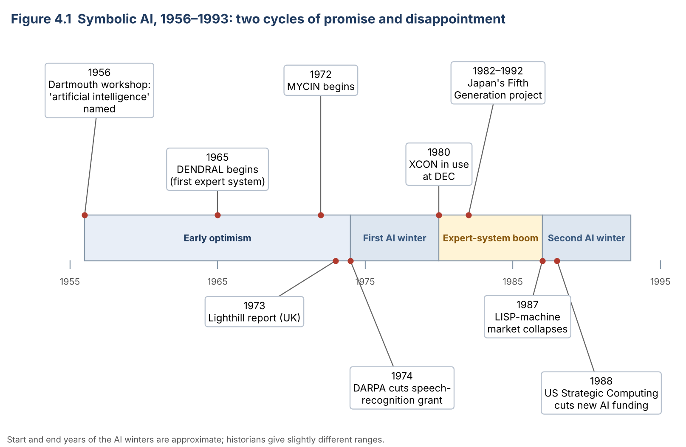

# Topic 4: History: The Rise, the AI Winters and the Lessons

**Level:** Beginner  |  **Estimated time:** 35 minutes  |  **Status:** Drafted V2.0 (dates re-checked; awaiting peer review)
**Builds on:** [Topic 2](02-rules-and-inference.md) (expert systems and their limits) and [Topic 3](03-symbolic-ai-vs-machine-learning.md) (learning from data)  |  **Comes before:** [Topic 5: Symbolic AI in Modern Software](05-symbolic-ai-in-modern-software.md)

**Learning objectives.** After this topic you will be able to:

1. Place the main events in the history of symbolic AI on a timeline.
2. Explain what an "AI winter" is, and give one *expectations* cause and one *technology* cause for each of the two main winters.
3. Use the limits you met in Topic 2 to explain why the expert-system boom ended.
4. Check a historical claim against more than one source.

---

## 1. Why study the history?

You now know how a rule-based system works (Topic 2) and how it differs from machine learning (Topic 3). History shows what happened when people tried to use rules as the main route to intelligent machines. It explains **why** AI today looks the way it does, and it teaches a lesson that still matters: promises about AI can run far ahead of what the technology can do.

> **AI winter:** a period in which funding for and interest in AI research fall sharply, usually after expectations were set too high and results did not match them ([Wikipedia: AI winter](https://en.wikipedia.org/wiki/AI_winter)).

> **Funding:** money for research, mostly from governments (in this period, especially the UK government, the US defence research agency DARPA, and Japan's trade ministry) and from companies.

The story of symbolic AI is a cycle that happened twice:

```text
big promises  →  funding  →  results fall short  →  funding is cut ("winter")
```

---

## 2. Timeline



*Figure 4.1. The main events in this topic. (Drawn with `assets/diagram-sources/topic04_timeline.py`.)*

| Year(s) | Event | Phase |
|---|---|---|
| 1956 | **Dartmouth summer workshop.** John McCarthy, Marvin Minsky, Nathaniel Rochester and Claude Shannon organise an eight-week meeting; the term "artificial intelligence" was coined for this project ([Dartmouth Alumni Magazine](https://dartmouthalumnimagazine.com/articles/birth-artificial-intelligence)). | Optimism |
| 1965 | Work begins on **DENDRAL** at Stanford, often called the first expert system ([Britannica](https://www.britannica.com/technology/artificial-intelligence/Expert-systems)). | Optimism |
| 1972 | Work begins on **MYCIN** at Stanford (Topic 2, §8) ([Britannica](https://www.britannica.com/technology/artificial-intelligence/Expert-systems)). | Optimism |
| 1973 | **The Lighthill report.** Mathematician Sir James Lighthill reviews AI for the UK's Science Research Council and concludes that "in no part of the field have the discoveries made so far produced the major impact that was then promised" ([Lighthill, 1973](https://www.aiai.ed.ac.uk/events/lighthill1973/lighthill.pdf)). UK funding for AI research is sharply reduced. | First winter begins |
| 1974 | In the USA, DARPA cancels a speech-recognition research grant of about $3 million a year as it turns to research with direct military use ([Wikipedia: AI winter](https://en.wikipedia.org/wiki/AI_winter)). | First winter |
| ≈1974–1980 | **First AI winter.** | Winter |
| 1980 | **XCON** goes into everyday use at Digital Equipment Corporation (DEC) ([McDermott, 1981](https://aitopics.org/doc/journals:E2B8C719)). Companies start building expert systems. | Boom |
| 1982–1992 | Japan's **Fifth Generation Computer Systems** project, led by the Institute for New Generation Computer Technology (ICOT) under the trade ministry (MITI), aims at computers built for knowledge-based reasoning ([IPSJ Computer Museum](https://museum.ipsj.or.jp/en/computer/other/0002.html)). It builds several large parallel inference machines but falls well short of its original goals ([Nature, 1992](https://www.nature.com/articles/356273b0.pdf)). | Boom → disappointment |
| 1987 | The market for **LISP machines** (special computers built to run AI software) collapses within about a year, as cheaper general-purpose workstations become powerful enough ([Wikipedia: AI winter](https://en.wikipedia.org/wiki/AI_winter)). | Second winter begins |
| 1988 | The US Strategic Computing Initiative stops new spending on AI ([Wikipedia: AI winter](https://en.wikipedia.org/wiki/AI_winter)). | Second winter |
| ≈1987–1993 | **Second AI winter.** | Winter |

*Historians give slightly different start and end years for both winters; the ranges here are the commonly cited ones.*

---

## 3. Worked example: explaining a historical event step by step

History questions often ask **"why did X happen?"**. A useful method is to separate the causes into two kinds, then link them to the effect.

**Question:** Why did the first AI winter happen?

**Step 1: What was promised?** Early researchers expected that machines with general, human-like intelligence would arrive within a generation. The Dartmouth proposal itself hoped for major progress in a single summer.

**Step 2: What was delivered?** Programs that worked well on small, carefully chosen problems ("toy problems") but failed on real-world ones such as understanding ordinary language.

**Step 3: Why the gap? (technology cause)** Lighthill identified the **combinatorial explosion**: as a problem grows, the number of possibilities a program must consider grows so fast that the computer cannot check them all. Computers of the time were also slow, with very little memory.

> **Combinatorial explosion:** the very rapid growth in the number of possible combinations as a problem gets larger. *Example:* a password of 2 digits has 100 possibilities; 4 digits, 10,000; 8 digits, 100,000,000. Each extra digit multiplies the work by 10.

**Step 4: Who reacted, and how? (expectations cause → effect)** Funders compared the promises with the results. The UK government (after the Lighthill report) and DARPA in the USA cut funding.

**Step 5: Write the explanation.**

> The first AI winter happened because early promises of human-like intelligence (**expectations**) could not be met by the computers and methods of the time, which ran into the combinatorial explosion on real problems (**technology**). When reviews such as the Lighthill report (1973) made the gap clear, governments in the UK and USA cut funding (**effect**).

You will use the same method in Activity B.

---

## 4. The second winter: the limits of rules

This part connects directly to Topic 2. The expert-system boom of the 1980s ran into exactly the limits you met in the animal identifier:

| Limit you saw in Topic 2 | What happened in industry |
|---|---|
| The system knows only what its rules cover (Activity Part D) | Systems failed on unusual cases; they were described as **brittle** |
| Adding a rule can create a conflict (Activity Part F) | Large rule bases became very costly to update and maintain. XCON, for example, needed expensive rewriting ([Middlesex University notes](https://cwa.mdx.ac.uk/bis2040/lect6ES2/xCon.html)) |
| No learning (Topic 3) | Every change needed human experts and programmers |

At the same time, the special hardware that AI companies sold (LISP machines) was overtaken by cheaper ordinary computers, and that whole industry disappeared within about a year ([Wikipedia: AI winter](https://en.wikipedia.org/wiki/AI_winter)).

### What came next

Rule-based AI did **not** disappear. It stopped being sold as a path to human-like intelligence and became an ordinary software technique (Topic 5). Meanwhile, research moved towards approaches that **learn from data** (Topic 3), which later benefited from much faster computers and much more data.

---

## 5. Common misunderstandings

| Misunderstanding | What is actually true |
|---|---|
| "During an AI winter, all AI research stopped." | Funding and public interest fell sharply, but research continued at a smaller scale. Some expert systems, such as XCON, stayed in use. |
| "Symbolic AI failed, so it was abandoned." | It failed to deliver **general** intelligence, but rule-based methods are still used widely (Topic 5). |
| "The winters were caused only by slow computers." | Over-promising mattered just as much. Both winters followed periods when expectations ran far ahead of results. |
| "History dates are fixed facts." | Exact dates and amounts can differ between sources. In V2.0 we found that one source dated the Fifth Generation project to 1981–1991, while the project's own museum record and a 1992 *Nature* report give 1982–1992 (see Activity D). |

---

## 6. Learner activities

**Activity A: put events in order.** Arrange these five events in time order: Fifth Generation project starts · Dartmouth workshop · LISP-machine market collapses · Lighthill report · XCON enters use.

**Activity B: explain a decision (use the method in §3).** Explain why the second AI winter happened. Your answer must include at least one **expectations** cause, one **technology** cause, and a link to a limit you saw in Topic 2.

**Activity C: predict.** It is 1985. A company asks you to build an expert system that answers *any* customer question about *any* of its 5,000 products. Using what you learned in Topic 2 and this topic, predict two problems the project would face.

**Activity D: check a claim (find the error).** A website says: *"Japan's Fifth Generation project ran from 1981 to 1991 and cost $850 million."* Using the sources in §2 and the references below, which parts can you confirm, and which parts disagree with other sources? What should a careful writer do?

---

## 7. Expected outcomes and answers

### Activity A

Dartmouth workshop (1956) → Lighthill report (1973) → XCON enters use (1980) → Fifth Generation project starts (1982) → LISP-machine market collapses (1987).

### Activity B (model answer)

> In the 1980s, companies and governments expected expert systems, and projects such as Japan's Fifth Generation programme, to deliver far more than they did (**expectations**). In practice, rule-based systems were brittle: like the animal identifier in Topic 2, they failed on cases their rules did not cover, and every new rule risked conflicts, so large systems became very expensive to maintain (**technology / link to Topic 2**). At the same time, cheaper general-purpose computers replaced special LISP machines, and that market collapsed in 1987 (**technology**). As funding was cut, interest fell, which is the second AI winter.

A full-credit answer names one expectations cause, one technology cause, and explicitly mentions a Topic 2 limit (gap in the knowledge base, rule conflict, or no learning).

### Activity C

Any two of the following, with a reason:
- **Gaps (brittleness):** customers will ask questions no rule covers, and the system will fail or give a wrong answer (Topic 2, Part D).
- **Combinatorial growth and maintenance:** 5,000 products need thousands of rules; each new or changed product needs new rules, and new rules can conflict with old ones (Topic 2, Part F).
- **Expert time:** experts must state every rule, and they may disagree with each other. (XCON's developers met disagreements between DEC's own experts ([Wikipedia: XCON](https://en.wikipedia.org/wiki/Xcon)).)
- **Language:** understanding free-form questions was one of the problems that defeated early AI (§3).

### Activity D

- **Confirmed:** it was a Japanese government project aimed at knowledge-based computing, and it fell short of its goals (IPSJ; *Nature*, 1992).
- **Disagree:** the **dates**: the IPSJ Computer Museum gives 1982–1992, and *Nature* (March 1992) says the ten-year project launched in 1982 and was extended by a year. The **cost**: IPSJ gives about ¥54 billion; *Nature* reports "over $400 million" after ten years. The $850 million figure appears in a secondary source but is not supported by these two.
- **What to do:** prefer the project's own records and reports from the time; when sources disagree, give the range or say "about", and cite the source used. (This is what we changed in V2.0 of this topic.)

### Common mistakes

1. Listing only "computers were slow" for both winters; the expectations cause is required.
2. Saying symbolic AI "ended" in the 1990s (see §5).
3. Treating any single website as enough to confirm a date or amount.

---

## 8. Summary

- AI's early history went through **two cycles** of big promises, funding, disappointment and funding cuts (**AI winters**, ≈1974–1980 and ≈1987–1993).
- The first winter came from over-promising and the **combinatorial explosion** on slow computers; the Lighthill report (1973) was a turning point in the UK.
- The second winter came from the limits of expert systems (**brittle**, costly to maintain, unable to learn) and the collapse of the LISP-machine market.
- Rules did not disappear; they became ordinary software tools, while research moved towards learning from data.

---

## 9. References

Links accessed 31 October 2026; Lighthill, IPSJ, *Nature* and McDermott sources added 3 November 2026.

1. Hertog, J. *The Birth of Artificial Intelligence.* Dartmouth Alumni Magazine. https://dartmouthalumnimagazine.com/articles/birth-artificial-intelligence
2. Encyclopaedia Britannica. *Artificial intelligence: Expert systems.* https://www.britannica.com/technology/artificial-intelligence/Expert-systems
3. Lighthill, J. (1973). *Artificial Intelligence: A General Survey.* Science Research Council (UK). Copy hosted by the University of Edinburgh AIAI. https://www.aiai.ed.ac.uk/events/lighthill1973/lighthill.pdf
4. McDermott, J. (1981). R1: The formative years. *AI Magazine*, 2(2). https://aitopics.org/doc/journals:E2B8C719
5. Information Processing Society of Japan, Computer Museum. *Fifth Generation Computer Systems (FGCS) project.* https://museum.ipsj.or.jp/en/computer/other/0002.html
6. *Nature* (26 March 1992). Japan stubs its toes on fifth-generation computer. *Nature* 356, 273. https://www.nature.com/articles/356273b0.pdf
7. Huyck, C. *Configuration with R1/XCon.* BIS2040 course notes, Middlesex University. https://cwa.mdx.ac.uk/bis2040/lect6ES2/xCon.html
8. Wikipedia. *AI winter* (DARPA 1974, LISP-machine collapse 1987, Strategic Computing 1988). https://en.wikipedia.org/wiki/AI_winter
9. Wikipedia. *Xcon.* https://en.wikipedia.org/wiki/Xcon

**Still to confirm (see `docs/review-log.md`):** the DARPA grant (1974), LISP-machine collapse (1987) and Strategic Computing cut (1988) are supported only by Wikipedia. The combinatorial-explosion password example is the team's own illustration.
