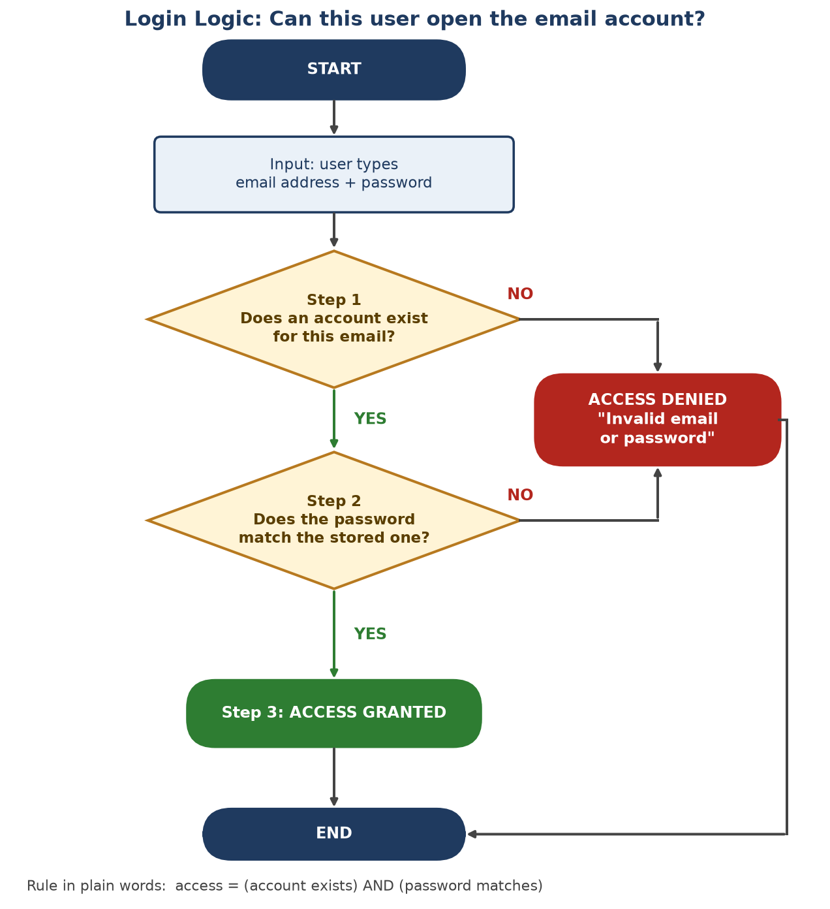

# Topic 1: Introduction to Software and Basic Logic

**Level:** Beginner  |  **Estimated time:** 25 to 30 minutes  |  **Leads into:** Topic 2, Symbolic AI (rule-based systems)

**Learning objectives.** After this topic you will be able to:
1. Explain what software is and how it differs from hardware.
2. Define an algorithm and a Boolean condition in your own words.
3. Trace a simple decision (a login check) step by step.
4. Write basic IF–THEN rules using true/false conditions.

---

## 1. Concept Explanation

A computer is a machine. On its own, it does nothing useful. It needs instructions. Those instructions are called **software**.

Software is not a physical thing. You cannot touch it. The physical parts of the computer (the screen, the chip, the battery) are called **hardware**. Software tells the hardware what to do.

Computers cannot guess or "get the idea". They follow instructions exactly, one step at a time, in the order given. If an instruction is unclear, the computer cannot ask what you meant.

So programmers write instructions as strict rules. Many of those rules are decisions, such as:

> IF the password is correct, THEN let the user in. OTHERWISE, refuse.

A decision like this depends on a question that has only two possible answers: **true** or **false**. The branch of logic that works with true/false questions is called **Boolean logic**. Every program you use, from a calculator to a video game, is built from this kind of simple, strict decision-making.

This matters for AI. The earliest approach to Artificial Intelligence, called **Symbolic AI**, works the same way. Experts write down their knowledge as IF–THEN rules, and the computer applies those rules. Symbolic AI used tools such as logic programming and production rules, and it produced applications such as expert systems ([Wikipedia: Symbolic artificial intelligence](https://en.wikipedia.org/wiki/Symbolic_AI)). If you understand how a basic program makes a decision, you already understand the foundation of that approach.

**Key idea:** Software = precise instructions. Many instructions are true/false decisions. Rule-based AI is built on the same idea.

---

## 2. Terminology

**Software:** Instructions that tell a computer what to do. It includes the whole set of programs, procedures and routines associated with the operation of a computer system, and the term was coined to distinguish these instructions from hardware, the physical components ([Britannica: Software](https://www.britannica.com/technology/software)). Two common types are system software (such as an operating system) and application software (such as a word processor or email app) ([BBC Bitesize](https://www.bbc.co.uk/bitesize/guides/zcg9kqt/revision/1)).
*Everyday example:* the email app on your phone.

**Algorithm:** A step-by-step procedure that solves a problem or answers a question in a finite number of steps ([Britannica: Algorithm](https://www.britannica.com/science/algorithm)). Each step must be clearly defined, and the process must eventually stop. A recipe is a good everyday comparison. A program is written to carry out one or more algorithms, so software contains algorithms ([Britannica Kids: Computer](https://kids.britannica.com/students/article/computer/273764)).
*Everyday example:* the steps a program follows to check a password.

**Boolean Logic:** A system of logic in which every statement is either true (1) or false (0), and statements are combined with three operators: AND, OR and NOT. It was first formulated by the English mathematician George Boole in 1847 ([Britannica: Boolean algebra](https://www.britannica.com/topic/Boolean-algebra)). The three operators work like this ([EBSCO Research Starters](https://www.ebsco.com/research-starters/science/boolean-algebra)):

| Operator | Meaning | Example |
|---|---|---|
| AND | True only if both parts are true | "Account exists" AND "password matches" |
| OR | True if at least one part is true | "Raining" OR "snowing" |
| NOT | Flips true to false, and false to true | NOT "account is locked" |

*Connection to rule-based AI:* the "IF" part of an AI rule is a Boolean condition. When it evaluates to true, the rule fires and its "THEN" action runs. In rule-based expert systems, a condition can have several parts joined by AND or OR ([Rule-Based Expert Systems lecture notes, Al-Mustansiriyah University](https://uomustansiriyah.edu.iq/media/lectures/6/6_2019_02_19!06_52_45_PM.pdf)).

---

## 3. Worked Example / Demonstration

**Question:** How does an email app decide whether a user may log in?

**What the program receives (the input):** an email address and a password typed by the user.

**Step 1: Does the account exist?**
The program looks up the email address in its list of accounts.
- Found: the answer is **true**. Continue to Step 2.
- Not found: the answer is **false**. Stop and refuse access.

**Step 2: Does the password match?**
The program compares what the user typed with what it has stored for that account. (In well-built systems, passwords are not stored as plain text. They are stored in scrambled form, "salted and hashed", and the program compares the scrambled versions ([NIST SP 800-63B-4](https://nvlpubs.nist.gov/nistpubs/SpecialPublications/NIST.SP.800-63B-4.pdf)).)
- Match: the answer is **true**. Continue to Step 3.
- No match: the answer is **false**. Stop and refuse access.

**Step 3: Decide and respond.**
- If Step 1 AND Step 2 were both true, grant access and open the inbox.
- Otherwise, deny access.

**The same logic as one Boolean rule:**

```text
access_granted = (account_exists) AND (password_matches)
```

**Truth table (every possible combination):**

| Account exists? | Password matches? | Result |
|---|---|---|
| True | True | **Access granted** |
| True | False | Access denied |
| False | True* | Access denied |
| False | False | Access denied |

*A password cannot match an account that does not exist, but the table shows the full logic of AND: only one row out of four gives "granted".

**The same logic as simple program-style text (pseudocode):**

```text
IF account_exists THEN
    IF password_matches THEN
        show inbox
    ELSE
        show "Invalid email or password"
ELSE
    show "Invalid email or password"
```

**A design detail worth noticing.** Both failure paths show the same message. This is deliberate. Security guidance says an application should respond with a generic message, such as "Login failed; Invalid user ID or password", whether the user ID or the password was wrong, so that attackers cannot discover which email addresses have accounts ([OWASP Authentication Cheat Sheet](https://cheatsheetseries.owasp.org/cheatsheets/Authentication_Cheat_Sheet.html)). Even this small piece of software is a set of strict, carefully chosen rules.

---

## 4. Visual Aid



*Caption: A standard decision tree used in basic software applications. Diamonds are yes/no (Boolean) questions. The program can only reach "Access granted" by answering YES to both questions. Any NO leads to "Access denied".*

**How to read it:** start at the top and follow the arrows. Rounded boxes mark the start, end and outcomes. The rectangle is the input. Each diamond is one Boolean test with exactly two exits.

---

## 5. Learner Activity

**Scenario:** You are writing the rules for a smart thermostat.

**Task:** Using the logic steps we just covered, write out the 3 specific rules the software must follow to turn on the heater if the temperature drops below 18°C.

*Hints:*
- In the login example, the steps were: get the input, test a true/false condition, then act on the result.
- "Below 18°C" is a comparison. It is either true or false for any given reading.
- Decide what the heater should do when the condition is false.

Write your three rules before checking the next section.

---

## 6. Expected Outcome / Answer

**Model answer:**

| Rule | What the software does | Login-example equivalent |
|---|---|---|
| **Rule 1: Read the input** | Read the current temperature from the sensor, and call it `T`. | The user types an email and password. |
| **Rule 2: Test the condition** | Evaluate the Boolean condition `T < 18`. The result is **true** or **false**. | Steps 1 and 2: the "account exists?" and "password matches?" questions. |
| **Rule 3: Act on the result** | IF the condition is true, THEN turn the heater **ON**. OTHERWISE, leave the heater **OFF**. | Step 3: grant or deny access. |

**As pseudocode:**

```text
T = read temperature sensor
IF T < 18 THEN
    heater = ON
ELSE
    heater = OFF
```

**Why this is correct:**
- It is an **algorithm**. It is a short, ordered, unambiguous list of steps that finishes with a result, which matches the definition of an algorithm ([Britannica: Algorithm](https://www.britannica.com/science/algorithm)). A real thermostat would simply repeat this routine at regular intervals.
- Rule 2 is a **Boolean** test. `T < 18` can only be true or false, so the program always knows what to do next ([Britannica: Boolean algebra](https://www.britannica.com/topic/Boolean-algebra)).
- Rule 3 is an **IF–THEN rule**, the same structure used by rule-based AI systems, where a rule "fires" when its IF condition is satisfied ([Rule-Based Expert Systems lecture notes](https://uomustansiriyah.edu.iq/media/lectures/6/6_2019_02_19!06_52_45_PM.pdf)).
- The rules are **strict**. At exactly 18.0°C the condition `T < 18` is false, so the heater stays off. The phrase "below 18" means strictly less than. If you wrote `T <= 18`, you changed the rule. Precision like this is what software needs.

**Common mistakes to check for:**
1. Skipping Rule 1 (the program has to read the temperature before it can compare it).
2. Writing a vague rule such as "if it's cold, heat it". "Cold" is not a defined true/false condition.
3. Forgetting what happens when the condition is false.

**Stretch question (optional):** Add a second condition so the heater turns on only if the temperature is below 18°C AND someone is home. Which Boolean operator did you use? *(Answer: AND. The heater turns on only when both conditions are true.)*

**Looking ahead.** In Topic 2 you will see that a Symbolic AI system is made of many rules like Rule 3, stored in a knowledge base and applied by an inference engine ([Microsoft AI for Beginners: Symbolic AI](https://github.com/microsoft/AI-For-Beginners/blob/main/lessons/2-Symbolic/README.md)).

---

## 7. References

All links were accessed on 21 October 2026. Format: Author or Publisher, Year (where stated), Title, Link.

**Software and algorithms**
1. Encyclopaedia Britannica. Software. https://www.britannica.com/technology/software
2. Encyclopaedia Britannica. Algorithm. https://www.britannica.com/science/algorithm
3. Encyclopaedia Britannica Kids. Computer. https://kids.britannica.com/students/article/computer/273764
4. BBC Bitesize. What is software? (Computational constructs, National 4). https://www.bbc.co.uk/bitesize/guides/zcg9kqt/revision/1

**Boolean logic**
5. Encyclopaedia Britannica. Boolean algebra. https://www.britannica.com/topic/Boolean-algebra
6. EBSCO Research Starters. Boolean algebra. https://www.ebsco.com/research-starters/science/boolean-algebra
7. Plus Maths (University of Cambridge). Maths in a minute: Boolean algebra. https://plus.maths.org/maths-minute-boolean-algebra
8. Stanford University, Computer Science. Boolean Expressions (Python). https://cs.stanford.edu/people/nick/py/python-boolean.html

**Login logic and security**
9. OWASP Foundation. Authentication Cheat Sheet. https://cheatsheetseries.owasp.org/cheatsheets/Authentication_Cheat_Sheet.html
10. Temoshok, D., et al. (2025). NIST Special Publication 800-63B-4, Digital Identity Guidelines: Authentication and Authenticator Management. National Institute of Standards and Technology. https://nvlpubs.nist.gov/nistpubs/SpecialPublications/NIST.SP.800-63B-4.pdf

**Rule-based and Symbolic AI (preview for Topic 2)**
11. Wikipedia. Symbolic artificial intelligence. https://en.wikipedia.org/wiki/Symbolic_AI
12. Microsoft. AI for Beginners, Lesson 2: Knowledge Representation and Expert Systems (Symbolic AI). https://github.com/microsoft/AI-For-Beginners/blob/main/lessons/2-Symbolic/README.md
13. Al-Mustansiriyah University. Rule-Based Expert Systems (lecture notes). https://uomustansiriyah.edu.iq/media/lectures/6/6_2019_02_19!06_52_45_PM.pdf
14. PBS (further viewing) / Crash Course. Artificial Intelligence #10: Symbolic AI. https://www.pbs.org/video/symbolic-ai-10-tfkalm/
